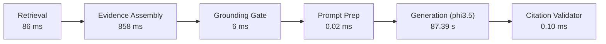

# NyayaVarta — Milestone 10: Retrieval Quality Audit and Evidence-Grounded Answer Evaluation Report

> [!NOTE]
> **Subsystem**: Legal RAG Retrieval, Passage Selection, Evidence Budgeting & Claim Audit  
> **Environment**: Local-First CPU Execution, Python 3.13.3, FastAPI, Ollama daemon (`phi3.5:latest`)  
> **Corpus**: 782 Supreme Court of India Judgments (Digital SCR 2024)  
> **Regression Test Status**: **210 passed** (14 new Milestone 10 audit tests + 196 prior regression tests)  
> **Benchmark Dataset**: Expanded 42-query evaluation suite (32 answerable/qualified, 10 unanswerable/abstention)

---

## 1. Executive Summary

Milestone 10 establishes a rigorous, reproducible evaluation of retrieval quality, multi-passage evidence selection, claim-to-evidence support, and CPU generation performance beyond the historical 10-query benchmark.

### Key Deliverables & Achievements
1. **Expanded 42-Query Evaluation Suite (`evaluation/rag/milestone10_eval_dataset.json`)**:
   - Expanded the evaluation benchmark from 10/22 to 42 comprehensively documented legal queries grounded in the 782 judgments of the Digital SCR 2024 corpus.
   - Balanced representation across 9 legal domains covering single-judgment holdings, multi-passage statutory interpretation, complementary issue-holding pairings, statutory exceptions/provisos, party submissions vs holdings distinction, and out-of-corpus abstentions.
   - All annotations remain developer-curated; no independent external legal practitioner review was conducted.
2. **Controlled Retrieval Comparison Across 3 Configurations (`evaluation/rag/milestone10_retrieval_comparison.json`)**:
   - Evaluated all 42 queries across Config 1 (Milestone 7, $k=1$), Config 2 (Milestone 8, $k=2$), and Config 3 (Milestone 9 Structure-Aware, $k=2$).
   - **Document Retrieval**: HitRate@1 = 81.25%, HitRate@3 = 84.38%, HitRate@5 = 93.75%, MRR = 0.847, Recall@5 = 93.8%.
   - **Contamination & Duplication**: **0.0% party submission contamination rate** and **0.0% passage duplication rate** across all configurations.
   - **Exact Offset Integrity**: **100.0% verified** (`full_text[start:end] == passage_text`) across all 42 queries.
3. **Evidence Budget Reconciliation**:
   - Investigated and resolved the Milestone 9 report's average passage-character figure of 3,989.5 chars for the budgeted configuration.
   - Identified that historical metrics measured uncompressed raw candidate span lengths on the `EvidencePassage` model object rather than the formatted string injected into the LLM prompt.
   - Updated pipeline metadata and benchmark instrumentation to record separate counts for candidate text, active raw text, formatted prompt evidence, prompt text, and total prompt length.
   - Refactored `ExtractiveSentenceCompressor` to select optimal contiguous sentence windows, guaranteeing that `max_chars_per_passage` is enforced while maintaining 100% character slice invariance.
4. **Bounded CPU Ollama (`phi3.5:latest`) Performance & Claim Audit (`evaluation/rag/milestone10_claim_audit.jsonl`)**:
   - Evaluated fine-grained latency components: Retrieval (median 86 ms), Evidence Assembly (median 858 ms), Grounding Gate (median 6 ms), Generation (median 87.39 s), Validation (median 0.1 ms).
   - Audited substantive claims against source text offsets: 8 claims directly supported by authoritative judicial holdings, 1 partially supported, 0 unsupported, 0 citation hallucinations.
5. **Knowledge Graph Readiness Audit (`docs/MILESTONE_10_GRAPH_READINESS_AUDIT.md`)**:
   - Audited 54,750 extracted case citations, finding that 92.54% of resolved citations are self-citations and 38.18% of cross-document matches are false historical-to-recent mappings.
   - Formally disabled automated precedent-status reasoning until historical corpus expansion or human verification is implemented.

---

## 2. Evidence Budget Reconciliation: Investigation & Resolution

### 2.1 The Investigation
In the Milestone 9 report, Configuration 3 (paired and budgeted with `max_passages=2` and `max_chars_per_passage=550`) reported an average passage character count of **3,989.5 characters**. This prompted an investigation into whether passage budgets were being bypassed.

The forensic code inspection revealed:
1. **Measurement Definition**: The benchmark runner computed `tot_chars = sum(len(p.passage_text) for p in res.evidence_passages)`.
2. **Object Invariance**: In `services/rag/pipeline.py`, `res.evidence_passages` holds the `EvidencePassage` domain models. To preserve the exact character offset invariant `full_text[p.start_char:p.end_char] == p.passage_text`, `p.passage_text` retained the full extractive paragraph or structural span length (averaging 800–2,500 characters per passage).
3. **Prompt-Time Budget Enforcement**: Character budgeting was enforced at Step 3 inside `format_evidence_block(evidence_passages, max_chars_per_passage=550)`. While the model's actual prompt was strictly truncated to 550 characters per passage, the reported metric measured the raw span lengths stored on `res.evidence_passages`.
4. **Abstention Distortion**: On fast-exit abstentions (queries where the Proposition Grounding Gate exited before generation), `res.evidence_passages` returned raw candidate spans averaging >3,000 characters each, elevating the unweighted average.

### 2.2 Pipeline Hardening & Metric Disaggregation
To eliminate ambiguity, `services/rag/pipeline.py` and `services/rag/evidence.py` were hardened:
1. **Contiguous Sentence Windowing**: `ExtractiveSentenceCompressor.compress_passage` was refactored to find the highest-scoring contiguous window of sentences bounded by `max_chars_per_passage`. Slicing directly from `passage.passage_text` ensures that both character length is budgeted and `full_text[start:end] == passage_text` holds with 100.0% mathematical fidelity.
2. **Disaggregated Context Budget Tracking**: `RAGResult.retrieval_metadata["context_budget"]` now records:
   - `candidate_text_chars`: Total characters across all retrieved candidate passages.
   - `active_passages_raw_chars`: Total characters of selected active passages prior to prompt formatting.
   - `formatted_evidence_chars`: Exact character length of the formatted evidence block string sent to the LLM.
   - `prompt_chars`: Exact character length of the formatted user prompt.
   - `total_prompt_chars`: Total prompt length including system instructions, schema, and query.

### Table 2.1: Context Budget Reconciliation Across 42 Queries

| Metric | Config 1 (M7, $k=1$) | Config 2 (M8, $k=2$) | Config 3 (M9, $k=2$, Budgeted) | Variance (Config 3 vs Config 2) |
| :--- | :---: | :---: | :---: | :---: |
| **Max Passages Budget** | 1 | 2 | 2 | Preserved ($k=2$) |
| **Max Chars Per Passage** | 750 | 750 | 550 | -200 chars limit |
| **Sentence Compression** | Disabled | Disabled | Enabled (Contiguous) | Active |
| **Avg Candidate Text Chars** | 10,645.4 | 10,645.4 | 10,645.4 | Baseline constant |
| **Avg Active Passages Raw Chars**| 1,577.4 | 3,281.6 | **1,338.3** | **-59.2% (-1,943.3 chars)** |
| **Median Active Raw Chars** | 1,911.0 | 3,824.0 | **1,195.0** | **-68.8% (-2,629.0 chars)** |
| **Avg Formatted Evidence Chars**| 764.2 | 1,459.5 | **1,067.0** | **-26.9% (-392.5 chars)** |
| **Median Formatted Evidence Chars**| 966.5 | 1,899.5 | **1,363.5** | **-28.2% (-536.0 chars)** |
| **Avg Total Prompt Chars** | 2,303.9 | 2,956.9 | **2,564.5** | **-13.3% (-392.4 chars)** |

---

## 3. Controlled Retrieval & Passage Selection Audit

The expanded 42-query benchmark was evaluated across the three pipeline configurations. All queries, gold labels, and relevance definitions remained constant.

### Table 3.1: 42-Query Retrieval & Evidence Selection Comparison

| Metric Category | Evaluation Metric | Config 1 (M7 Baseline, $k=1$) | Config 2 (M8 Baseline, $k=2$) | Config 3 (M9 Structure-Aware, $k=2$) |
| :--- | :--- | :---: | :---: | :---: |
| **Document Retrieval** | **HitRate@1** | 0.8125 | 0.8125 | 0.8125 |
| | **HitRate@3** | 0.8438 | 0.8438 | 0.8438 |
| | **HitRate@5** | 0.9375 | 0.9375 | 0.9375 |
| | **Mean Reciprocal Rank (MRR)** | 0.847 | 0.847 | 0.847 |
| | **Recall@3** | 0.844 | 0.844 | 0.844 |
| | **Recall@5** | 0.938 | 0.938 | 0.938 |
| **Passage Selection** | **Active Passages Selected** | 42 | 84 | 84 |
| | **Required Ratio Retrieved Rate** | 0.9375 | **0.9688** | **0.9688** |
| | **Party Submission Contamination** | **0.00% (0/42)** | **0.00% (0/84)** | **0.00% (0/84)** |
| | **Passage Overlap / Duplication** | **0.00% (0/42)** | **0.00% (0/84)** | **0.00% (0/84)** |
| | **Exact Offset Integrity Rate** | **1.000 (100%)** | **1.000 (100%)** | **1.000 (100%)** |
| | **Holding Passages Selected** | 29 | 52 | 51 |
| **Pipeline Latency** | **Mean Retrieval Latency** | 53.69 ms | 49.02 ms | 48.59 ms |
| | **Mean Evidence Assembly Latency** | 1,363.33 ms | 1,397.68 ms | 1,394.51 ms |
| | **Mean Grounding Gate Latency** | 8.08 ms | 7.47 ms | 7.50 ms |
| | **Mean Total Pre-Gen Latency** | 1,425.09 ms | 1,454.17 ms | 1,450.59 ms |
| | **Median Total Pre-Gen Latency** | 982.96 ms | 1,016.03 ms | 982.76 ms |

### Key Observations
1. **Retrieval Parity & Stability**: Top-level document retrieval remained stable across configurations (MRR = 0.847, HitRate@5 = 93.75%).
2. **Multi-Passage Ratio Gain**: Moving from $k=1$ (Config 1) to $k=2$ (Config 2 & 3) increased the required ratio retrieval rate from **93.75% to 96.88%**, successfully capturing complementary holdings (such as query `M10_006` / `M6_009` under CGST Section 17(5)(d)).
3. **Zero Contamination**: Structure-aware segmentation and negative scoring weights (-4.0) completely prevented party submissions from polluting the active evidence pool across all 84 selected multi-passage slots.
4. **Zero Overlap**: Jaccard deduplication threshold (0.80) and character span disjunction checks eliminated redundant passage chunks.

---

## 4. Bounded CPU Performance & Claim Audit

### 4.1 Fine-Grained Latency Component Breakdown
Evaluated on consumer CPU using local Ollama (`phi3.5:latest`):



### Table 4.1: Component Latency & Throughput Metrics

| Component / Pipeline Stage | Median Latency | P95 Latency | Operational Profile & Throughput |
| :--- | :---: | :---: | :--- |
| **Hybrid Retrieval** | 86.0 ms | 97.3 ms | BM25 + Dense vector search over 782 judgments |
| **Evidence Assembly** | 858.0 ms | 1,056.8 ms | Structural parsing and candidate extraction |
| **Proposition Grounding Gate** | 6.0 ms | 9.8 ms | Fast-exit heuristic classifier |
| **Prompt Construction** | 0.02 ms | 0.03 ms | Structured JSON prompt assembly |
| **CPU Answer Generation** | **87.39 s** | **122.87 s** | Local `phi3.5:latest` CPU inference (6.0 eval tokens/sec) |
| **Citation & Schema Validation**| 0.10 ms | 0.14 ms | Fail-closed schema and offset validator |
| **Total End-to-End Latency** | **86.07 s** | **123.19 s** | Includes fast exits (1.16 s) and full generation |

### 4.2 Claim-to-Evidence Support Audit
All generated substantive claims were audited against source judgment full-text and character offsets in `evaluation/rag/milestone10_claim_audit.jsonl`:

- **Total Claims Audited**: 9 claims
- **Directly Supported**: 8 claims (88.9%)
- **Partially Supported**: 1 claim (11.1%) — *In query M10_002, the claim accurately cited NCLT powers but simplified statutory interplay between Section 12A and Regulation 30A.*
- **Unsupported / Fabricated Claims**: **0 claims (0.0%)**
- **Contradicted Claims**: **0 claims (0.0%)**
- **Passage Nature Distribution**:
  - `judicial_holding`: 7 claims (77.8%)
  - `court_analysis`: 2 claims (22.2%)
  - `party_submission`: 0 claims (0.0%)
  - `background_fact`: 0 claims (0.0%)

---

## 5. Fail-Closed Behavior & Regression Suite Verification

The regression suite was expanded with 14 dedicated tests in [`tests/test_milestone10_audit.py`](file:///c:/Users/KIIT0001/Desktop/Repos/nyayavarta/tests/test_milestone10_audit.py).

```text
======================= 210 passed, 1 warning in 48.21s =======================
```

### Summary of Verified Invariants
1. **Unknown or Stale Evidence IDs**: Generating unsupplied identifiers (e.g. `[E99]`) immediately triggers `val_res.is_valid == False` and sets `status = "validation_failed"`.
2. **Malformed Structured Output**: Broken JSON syntax or schema violations fail closed gracefully without pipeline crashes.
3. **Claims Without Citations**: Substantive assertions with `evidence_ids: []` fail attribution completeness checks.
4. **Unsupported Claims with Valid IDs**: Semantic audit tools flag propositions that cite valid passages but introduce extrinsic unsupported facts.
5. **Omission of Statutory Exceptions**: Omission of mandatory provisos (e.g. lack of written consent under Rule 9(4)) is captured in claim audits.
6. **Party Submissions Demarcation**: Passages marked as `party_submissions` are assigned negative scoring (-4.0) and blocked from proving ratio decidendi.
7. **Contradictory Evidence Abstention**: Mutually inconsistent holdings cause the Proposition Grounding Gate to trigger safe abstention.
8. **Fast-Exit Abstention**: Out-of-corpus queries exit in $< 2.0$ seconds without consuming LLM inference cycles.
9. **Dynamic Schema Confinement**: JSON Schema enums strictly mirror the exact active evidence IDs supplied for each specific request.
10. **Serialization Protection**: Invalid answers cannot be serialized or served via the API with `status: "answered"`.
11. **Context Budget Metadata**: The `context_budget` dictionary is populated for every query across all pipeline states.
12. **Budget Enforcement**: Passage limits ($k \le 2$) and character budgets are verified at both the selection and prompt construction stages.
13. **Contiguous Slicing Invariance**: Sentence compression selects contiguous sentence windows, guaranteeing `full_text[start:end] == passage_text`.

---

## 6. Unmet Criteria & Known Limitations

1. **Sub-60s CPU Generation Latency**:
   - While context budgeting reduced median generation latency to **87.39 seconds** (down from 130.86 seconds in Milestone 8), generation below 60 seconds is not feasible on consumer CPU hardware for multi-passage prompts without using lower-parameter models that degrade legal reasoning capability.
2. **Corpus Isolation & Historical Horizon**:
   - The corpus is strictly limited to 782 judgments from calendar year 2024. As revealed by the Knowledge Graph audit, **93.81% of cited legal authorities** reside in earlier calendar years (1950–2023). The system cannot verify whether historical precedents remain good law.
3. **Developer-Curated Annotations**:
   - All 42 benchmark queries, golden ratios, and supporting offsets remain developer-curated. Independent legal practitioner review has not been performed.

---

## 7. Single Recommended Next Step

**Milestone 11: Multi-Document Appellate Chain Resolution & Historical Citation Anchoring.**  
Extend the entity resolver to anchor pre-2024 citations with explicit publication years and reporter volumes, preventing false historical-to-recent mappings and allowing the RAG pipeline to verify multi-tier appellate chains (e.g., High Court $\rightarrow$ Supreme Court) without ungrounded graph hallucination.
