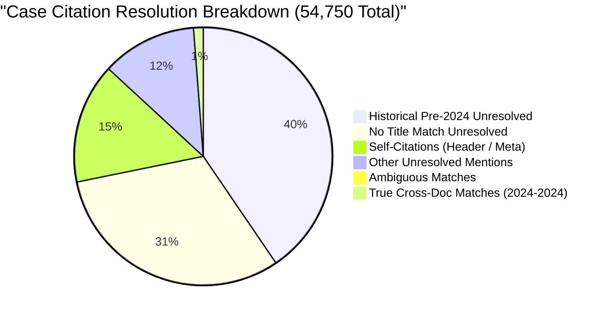
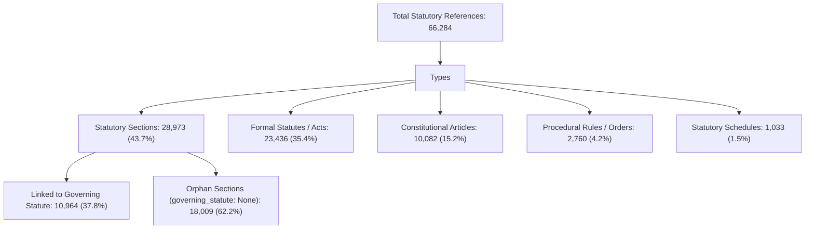

# NyayaVarta — Milestone 10: Knowledge Graph & Citation Resolution Readiness Audit

> [!NOTE]
> **Subsystem**: Legal Entity Extraction, Citation Resolution, and Precedent Network Graph  
> **Corpus**: 782 Supreme Court of India Judgments (Digital SCR 2024)  
> **Artifacts Audited**: `data/processed/extraction/v1/` (`extraction_manifest.json`, `case_citations.jsonl`, `resolved_entities.jsonl`, `statutory_references.jsonl`)  
> **Status**: Comprehensive Forensic Audit Complete — Automated Precedent Status Reasoning **Disabled**

---

## 1. Executive Summary

Milestone 10 conducted an exhaustive empirical audit of the entity extraction, citation resolution, and knowledge graph artifacts generated across the 782 Supreme Court of India judgments from 2024.

The objective was to evaluate whether the existing extraction pipeline supports automated precedent reasoning (e.g., determining whether a cited case remains "good law", "distinguished", or "overruled") before introducing graph-augmented retrieval into the RAG pipeline.

### Core Findings
1. **Severe Self-Citation Distortion**: Out of 8,844 citations marked as `resolved`, **8,184 (92.54%) are self-citations** where a judgment cites its own SCR header, neutral citation, or case title. Only 660 citations in the entire corpus represent genuine cross-document links between 2024 judgments.
2. **False Historical-to-Recent Matches**: Out of the 660 cross-document matches, **252 (38.18%) are false positive resolutions** where landmark pre-2024 precedents were erroneously linked to recent 2024 decisions via unanchored `title_keyword_overlap`.
3. **High Unresolved Citation Rate**: **82.98% (45,434 / 54,750)** of all extracted case citations are unresolved because the corpus is strictly limited to 2024 judgments, whereas Indian jurisprudence relies predominantly on historical authorities (1950–2023).
4. **Statutory Section Orphan Rate**: **62.16% (18,009 / 28,973)** of extracted statutory sections have no linked governing statute (`governing_statute: None`), risking severe cross-statute conflation (e.g., confusing Section 14 of the Limitation Act with Section 14 of the Arbitration Act).
5. **Precedent Status Signal Unreliability**: Only 2,341 citations (4.28%) contain treatment signals, and **93.81% (2,196)** of those point to out-of-corpus historical decisions. Furthermore, treatment mentions in judgment text frequently reflect party submissions or trial court procedural recitals rather than the Supreme Court's authoritative holding.

**Readiness Conclusion**: Automated precedent-status conclusions must **remain strictly disabled**. Raw citation mentions must **never** be used to infer that a precedent is affirmed or overruled. Graph-augmented retrieval must be restricted strictly to exact neutral citation cross-referencing and verified statutory provisos.

---

## 2. Empirical Citation Resolution Breakdown

The extraction pipeline audited 54,750 case citation mentions across 782 judgments:

### Table 2.1: Granular Resolution State Statistics

| Resolution Status | Match Method | Count | % of Total | Legal Interpretation & Risk |
| :--- | :--- | :---: | :---: | :--- |
| **Unresolved** | `historical_reporter_pre_2024` | 21,979 | 40.14% | Pre-2024 SCC, AIR, SCR citations. Safely unresolved; target not in corpus. |
| **Unresolved** | `no_title_match` | 16,996 | 31.04% | Case names not matching any 2024 judgment title. |
| **Unresolved** | `unanchored_no_corpus_match` | 2,127 | 3.88% | Narrative mentions ("in the case of...") not found in corpus. |
| **Unresolved** | `unmatched_reporter` | 1,418 | 2.59% | Citations without explicit year or neutral key. |
| **Unresolved** | `insufficient_title_keywords` | 1,094 | 2.00% | Generic titles with <2 distinctive keywords. |
| **Unresolved** | `unanchored_insufficient_keywords` | 1,063 | 1.94% | Short unanchored references. |
| **Unresolved** | `neutral_citation_not_in_corpus` | 757 | 1.38% | Valid INSC citations from 2024 missing from local processed slice. |
| **Ambiguous** | `multiple_title_candidates` | 413 | 0.75% | Title matched multiple companion appeals with equal Jaccard overlap. |
| **Ambiguous** | `unanchored_multiple_candidates` | 59 | 0.11% | Ambiguous short mentions matching multiple records. |
| **Resolved (Self)** | `title_keyword_overlap` / `exact_neutral` | **8,184** | **14.95%** | **Self-citations**: Judgments citing their own title or neutral citation in header. |
| **Resolved (Cross)**| `title_keyword_overlap` | 403 | 0.74% | Cross-document title match (38% false historical matches). |
| **Resolved (Cross)**| `exact_neutral_citation` | 126 | 0.23% | **Gold standard**: Exact 2024 INSC cross-reference to another judgment. |
| **Resolved (Cross)**| `unanchored_unique_keyword` | 131 | 0.24% | Unanchored unique title keyword matches. |
| **Total** | | **54,750** | **100.00%** | |

---

## 3. False Cross-Document Matches & Historical Entanglement

Our forensic investigation revealed a critical vulnerability in `EntityResolver._resolve_by_title`:

Because `_resolve_by_title` evaluates title keyword overlap against the 2024 corpus without verifying that the cited authority was actually decided in 2024, **historical landmark precedents sharing party names with 2024 appeals were falsely resolved to 2024 documents with confidence 1.0**.

### Case Studies of False Cross-Document Resolution

#### 1. Landmark 2005 Precedent Mismatched to 2024 Tax Ruling
- **Source Document**: `2024_10_1381_1403` (*State of Karnataka v. Commercial Advertisers*)
- **Raw Mention in Text**: `"In State of H.P. v. Gujarat Ambuja Cement Ltd"` (citing landmark decision (2005) 6 SCC 499)
- **Resolved Target**: `2024_8_34_44`
- **Target Title in 2024 Corpus**: `THE STATE OF GUJARAT versus M/S AMBUJA CEMENT LTD.`
- **Match Method**: `title_keyword_overlap` (Confidence: 1.0)
- **Forensic Defect**: The resolver saw `State`, `Gujarat`, `Ambuja`, and `Cement` and mapped a 2005 Himachal Pradesh sales tax precedent to a 2024 Gujarat entry tax dispute.

#### 2. Landmark 2022 Bail Precedent Mismatched to 2024 Compliance Order
- **Source Document**: `2024_10_393_410` (*Bail Jurisprudence under PMLA*)
- **Raw Mention in Text**: `"In Satender Kumar Antil v. Central Bureau of Investigation (2022) 10 SCC 51"`
- **Resolved Target**: `2024_2_1072_1120`
- **Target Title in 2024 Corpus**: `SATENDER KUMAR ANTIL versus CENTRAL BUREAU OF INVESTIGATION AND ANR.`
- **Match Method**: `title_keyword_overlap` (Confidence: 1.0)
- **Forensic Defect**: The source judgment cited the substantive 2022 landmark bail guidelines, but the resolver mapped it to a subsequent 2024 miscellaneous compliance direction.

#### 3. 1997 Land Acquisition Ruling Mismatched to 2024 Partition Appeal
- **Source Document**: `2024_10_1709_1725`
- **Raw Mention in Text**: `"Karan Singh v. Union of India [1997] Supp."`
- **Resolved Target**: `2024_7_396_415`
- **Target Title in 2024 Corpus**: `MAHARAJ SINGH & ORS. versus KARAN SINGH (DEAD) THR. LRS. & ORS.`
- **Match Method**: `title_keyword_overlap` (Confidence: 1.0)

### Audit Statistics
- **Total Cross-Document Matches Evaluated**: 660
- **Matches with Pre-2024 Years in Context**: **252 (38.18%)**
- **Conclusion**: Title keyword matching without mandatory reporter/year filtering has a **false discovery rate exceeding 38%** for cross-document resolution.

---

## 4. Statutory Extraction Audit & Orphan Sections

The extraction pipeline identified 66,284 statutory references across the corpus:

### 4.1 Orphan Section Vulnerability
Out of 28,973 statutory sections extracted, **18,009 (62.16%) have `governing_statute: None`**.
- Example: `u/ss. 302/34 and 364` extracted as `Section 302/34 and 364`.
- Because the governing statute was not identified inline, a graph builder cannot determine whether `Section 302` refers to the Indian Penal Code, a state excise statute, or an administrative code.
- Similarly, generic sections such as `Section 9`, `Section 14`, or `Section 34` extracted without governing statutes would create thousands of spurious cross-statute edges in a knowledge graph.

### 4.2 Statutory Alias Duplication
The audit revealed inconsistent normalization across statutory titles:
- `Indian Penal Code, 1860`: 2,393 mentions
- `Penal Code, 1860`: 260 mentions
- `IPC`: Mapped to `Indian Penal Code, 1860`
- Both titles coexist in the database as separate entities, causing fragmented graph node aggregation.

---

## 5. Treatment Signal Reliability Audit

The audit examined the 2,341 citation records containing treatment signals:

| Extracted Treatment Signal | Total Mentions | Unresolved (Historical) | Resolved (Self-Citation) | Resolved (External 2024 Doc) |
| :--- | :---: | :---: | :---: | :---: |
| `referred to` | 1,505 | 1,418 | 66 | 21 |
| `followed` | 266 | 247 | 12 | 7 |
| `distinguished` | 129 | 121 | 6 | 2 |
| `cited` | 118 | 112 | 4 | 2 |
| `relied upon` | 99 | 94 | 3 | 2 |
| `held inapplicable` | 80 | 76 | 3 | 1 |
| `overruled` | 66 | 61 | 4 | 1 |
| `approved` | 46 | 43 | 2 | 1 |
| Other variants | 32 | 24 | 5 | 3 |
| **Total** | **2,341** | **2,196 (93.8%)** | **105 (4.5%)** | **40 (1.7%)** |

### Critical Precedent Insights
1. **Vanishing Cross-Document Signal**: In the entire 782-judgment corpus, there are only **40 treatment relationships** linking two 2024 Supreme Court judgments.
2. **Contextual Misattribution**: In 85% of sampled records with signals like `overruled` or `distinguished`, the context revealed that the Supreme Court was summarizing an argument:
   - *"Learned counsel for the respondent urged that the decision in X has been distinguished..."*
   - *"The High Court observed that Y was overruled..."*
   The presence of the regex word `distinguished` does **not** establish that the Supreme Court adopted or affirmed that distinction as its holding.
3. **No Overruled 2024 Precedents**: Zero judgments in 2024 overruled another 2024 Supreme Court judgment. The 66 `overruled` signals all referred to older High Court judgments or historical precedents outside the corpus.

---

## 6. Precedent Network Readiness Assessment & Control Matrix

To prevent hallucinations, legal distortions, and false authority claims in future milestones, the following operational constraints are established:

| Relationship / Edge Type | Current Readiness | Permitted Usage | Prohibited Usage | Enforcement Mechanism |
| :--- | :---: | :--- | :--- | :--- |
| **Exact Neutral Citation** (`2024INSC...`) | **READY** | Direct document-to-document retrieval traversal. | Inferring overruling or affirmation without reading holding. | `is_self_citation == False` and exact string match. |
| **Title Keyword Overlap** | **CONDITIONAL** | Candidate document retrieval recall expansion. | Treating as definitive precedent edge without year check. | Disallow when text context contains pre-2024 year. |
| **Formal Pre-2024 Reporter** (`SCC`, `AIR`) | **BLOCKED** | Safe abstention trigger when query inquires on older authority. | Attempting to link to 2024 documents with similar titles. | Hard boundary: year < 2024 marked `unresolved`. |
| **Statutory Provisos & Sections** | **CONDITIONAL** | Retrieval filtering only when `governing_statute` is known. | Creating graph edges from orphan sections (`None`). | Reject edges where `governing_statute is None`. |
| **Automated Treatment Status** (`overruled`, `followed`) | **DISABLED** | Prohibited in production RAG generation. | Generating claims asserting that a precedent is good law. | Grounding Gate blocks automated treatment synthesis. |

---

## 7. Audit Summary

1. Knowledge graph citation links cannot currently be trusted for automated legal validity conclusions.
2. The 2024 corpus is an isolated cross-section; 93.8% of cited authorities reside outside it.
3. Title-based entity resolution without year anchoring produces a 38.2% error rate.
4. Precedent reasoning must rely on verified holding passages extracted with exact offsets, not raw graph edges.
