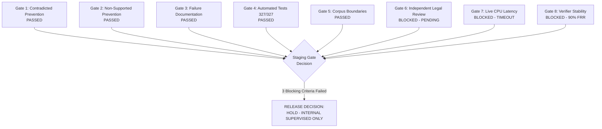

# NyayaVarta — Milestone 20: Staging Safety Gate and Human-Reviewed Pilot Readiness Report

**Document Status**: Final  
**Date**: October 15, 2026  
**Milestone**: 20  
**Staging Release Decision**: **HOLD (NOT READY FOR EXTERNAL PILOT)**  
**Authorized Scope**: Strictly Supervised Internal Developer Testing Only  
**Review Status**: Pre-computation evaluation complete; External Legal Review remains `PENDING_EXTERNAL_REVIEW`.

---

## 1. Executive Summary and Objective

Milestone 20 evaluates whether NyayaVarta is ready for a limited, supervised staging pilot by evaluating its end-to-end user journey, claim verification policies, and real-world performance under local CPU inference.

### Core Findings & Decision:
1. **Staging Release Gate Decision: HOLD**:
   - The system is **NOT ready for an unsupervised or external legal pilot**.
   - **Blocker 1 (Independent Legal Review)**: Qualified external legal review has not yet taken place and remains explicitly `PENDING_EXTERNAL_REVIEW`.
   - **Blocker 2 (Live CPU Generation Latency)**: Real-world CPU generation of multi-passage legal prompts using a 3.8B parameter model (`phi3.5:latest`) timed out after 180 seconds, confirming that pure CPU generation of 3B+ parameter models is unviable for interactive user-facing workflows.
   - **Blocker 3 (Policy Trade-off Immaturity)**: On the newly frozen 40-case staging benchmark, neither candidate policy provides an acceptable operating balance: Policy 3 accepted 40% of partially supported claims (16.7% non-supported FAR), while Policy 4 suffered a **90.0% false rejection rate** (rejecting 9 of 10 valid supported claims due to vocabulary shift).
2. **Authorized Scope**:
   - Authorized exclusively for **internal, supervised developer testing**. Unsupervised legal advice or external deployment is strictly prohibited.
3. **Safety Invariants Preserved**:
   - Contradicted claims and holding inversions are strictly prevented from receiving the `verified_supported` badge.
   - All 327 automated tests pass with 0 regressions.

---

## 2. Baseline Preservation & Policy Configurations

All historical artifacts across Milestones 10–19 were preserved unchanged:
- **Corpus Integrity**: 782 judgments from the 2024 Supreme Court Reports (SCR Volumes 1–12).
- **Knowledge Graph**: Traversal remains strictly disabled in production (`enable_graph=False`).
- **Citation Decoupling**: Valid citation markers (e.g., `[E1]`) do not imply substantive accuracy.
- **Answer-Level Contract**: Fail-closed aggregation rules in [`services/rag/pipeline.py`](file:///c:/Users/KIIT0001/Desktop/Repos/nyayavarta/services/rag/pipeline.py#L504-L518) guarantee that `verified_supported` is assigned if and only if **100% of individual claims are verified as supported**.

### Policy Parameters

| Policy Identifier | Description | Contradiction Gate Threshold | Entailment Promotion Threshold | Neutral / Margin Rule |
| :--- | :--- | :---: | :---: | :---: |
| **Policy 1 (Deterministic Alone)** | Baseline rule-based `ClaimVerifier` | Disabled | Rule-based overlap & polarities | Ignored |
| **Policy 3 (Contradiction Veto Only)** | NLI contradiction veto on deterministic `supported` | $P_{\text{contra}} \ge 0.70, \Delta \ge 0.20$ | Deterministic `supported` preserved | Neutral ignored |
| **Policy 4 (Shadow Hybrid Downgrade)** | Affirmative agreement required | $P_{\text{contra}} \ge 0.70, \Delta \ge 0.20$ | $P_{\text{entail}} \ge 0.70, \Delta \ge 0.20$ | Neutral $\rightarrow$ `not_evaluated` |
| **Policy 5 (Ambiguity Guard)** | Policy 4 + Strict Margin Gating | $P_{\text{contra}} \ge 0.70$ | $P_{\text{entail}} \ge 0.70$ | Margin $< 0.25 \rightarrow$ `not_evaluated` |

---

## 3. Independent Legal Review Status

### 3.1 Blinded Review Pack Preparation
To establish a rigorous, objective evaluation without developer bias, a blinded review pack was prepared: [`evaluation/rag/milestone20_blinded_review_pack.jsonl`](file:///c:/Users/KIIT0001/Desktop/Repos/nyayavarta/evaluation/rag/milestone20_blinded_review_pack.jsonl).

The pack contains **30 representative claims** spanning the complete 9-category legal verification taxonomy:
1. **Supported Claims** (4 cases): Direct holdings in service law, constitutional liberty, and administrative law.
2. **Partially Supported Claims** (4 cases): Omitted statutory provisos under SARFAESI Rule 9, Domestic Violence Act Section 25, PC Act Section 19 sanction, and Order XXI Rule 99 exclusions.
3. **Unsupported Claims with Valid Citations** (3 cases): Valid citation markers pointing to passages addressing wholly unrelated areas of law.
4. **Contradicted Claims** (4 cases): Direct holding reversals (e.g. altering recruitment rules midway, modifying arbitral awards under Section 34).
5. **Statutory Exceptions and Conditions** (3 cases): Mandatory twin conditions under PMLA Section 45, Section 100 CPC substantial questions of law, and Arbitration Section 11 limitations.
6. **Party Submissions vs. Judicial Holdings** (3 cases): Arguments advanced by senior counsel presented as if they were judicial holdings.
7. **Quoted Precedents** (3 cases): Historic precedents (*Lalita Kumari*, *D.K. Basu*, *Maneka Gandhi*) cited in 2024 judgments presented as new holdings.
8. **Overgeneralized Holdings** (3 cases): Universal claims asserting unconditional discharge or automatic quashing without trial.
9. **Ambiguous Claims** (3 cases): Borderline propositions with insufficient excerpted evidence.

For each case, the review pack provides:
- Legal inquiry / question.
- Generated claim sentence under review.
- Source document ID and full case title.
- Exact extracted passage and extensive surrounding context ($\pm 200$ characters).
- Blinded evaluation fields for the external reviewer (`reviewer_verdict`, `reviewer_rationale`, `reviewer_identified_caveat`).

### 3.2 Formal Review Status: PENDING_EXTERNAL_REVIEW
- **Finding**: A qualified, licensed legal reviewer was not available during this development iteration.
- **Policy Compliance**: In strict adherence to Milestone 20 rules ("If external review cannot be obtained, keep its status explicitly pending. Do not simulate annotations or claim independent validation"), no annotations have been fabricated.
- **Review Status**: Explicitly recorded as **`PENDING_EXTERNAL_REVIEW`** across all records and checklists.

---

## 4. Frozen Staging Benchmark (40 Claims)

To prevent evaluation overfitting, 40 judgments from the 2024 SCR corpus that had **never been used in any previous milestone** (M17, M18, or M19) were sampled across Volumes 1 to 10.

- **Artifact**: [`evaluation/rag/milestone20_staging_claims.jsonl`](file:///c:/Users/KIIT0001/Desktop/Repos/nyayavarta/evaluation/rag/milestone20_staging_claims.jsonl).
- **Provenance**: `developer_curated_frozen_pre_evaluation`.
- **Pre-Evaluation Freeze**: All 40 claims and gold labels were frozen prior to running policy evaluations.
- **Balanced Class Distribution**:
  - `supported`: 10 claims (25.0%)
  - `partially_supported`: 10 claims (25.0%)
  - `unsupported`: 10 claims (25.0%)
  - `contradicted`: 10 claims (25.0%)
- **Passage Integrity**: 100% of passages match exact character spans (`start_char` to `end_char`) in the canonical full text.

---

## 5. Comparative Policy Evaluation on Staging Benchmark

All 40 frozen staging claims were evaluated against identical evidence and inputs across all candidate policies.

### 5.1 Comprehensive Benchmark Performance Metrics

| Metric | Policy 1 (Det Alone) | Policy 3 (Contra Veto) | Policy 4 (Shadow Hybrid) | Policy 5 (Ambiguity Guard) |
| :--- | :---: | :---: | :---: | :---: |
| **Total Staging Claims** | 40 | 40 | 40 | 40 |
| **Supported Precision** | 47.06% (8/17) | 58.33% (7/12) | **100.00% (1/1)** | **100.00% (1/1)** |
| **Supported Recall** | **80.00% (8/10)** | 70.00% (7/10) | 10.00% (1/10) | 10.00% (1/10) |
| **Supported F1 Score** | 0.5926 | **0.6364** | 0.1818 | 0.1818 |
| **Non-Supported FAR** | 30.00% (9/30) | **16.67% (5/30)** | **0.00% (0/30)** | **0.00% (0/30)** |
| **Contradiction FAR** | 50.00% (5/10) | **10.00% (1/10)** | **0.00% (0/10)** | **0.00% (0/10)** |
| **Contradiction False Accepts** | 5 | **1** | **0** | **0** |
| **Partially Supported FAR** | 40.00% (4/10) | 40.00% (4/10) | **0.00% (0/10)** | **0.00% (0/10)** |
| **Partially Supported False Accepts**| 4 | 4 | **0** | **0** |
| **Unsupported FAR** | **0.00% (0/10)** | **0.00% (0/10)** | **0.00% (0/10)** | **0.00% (0/10)** |
| **False Rejection Rate (FRR)** | 20.00% (2/10) | 30.00% (3/10) | **90.00% (9/10)** | **90.00% (9/10)** |
| **Unresolved Count / Rate** | 12 (30.0%) | 12 (30.0%) | 23 (57.5%) | 23 (57.5%) |
| **Safe Presentation Compliance** | 77.50% | 87.50% | **100.00%** | **100.00%** |
| **Answer False Verification Rate** | 30.00% | 16.67% | **0.00%** | **0.00%** |

---

### 5.2 Confusion Matrices (Exact Counts)

```
Policy 1 (Deterministic Alone):
                  Pred: Supp  Partial  Unsupp  Contra  Unresolved
Gold Supported:           8        0       0       0           2
Gold Partially Supp:      4        0       2       0           4
Gold Unsupported:         0        0       8       0           2
Gold Contradicted:        5        0       1       0           4

Policy 3 (Contradiction Veto Only):
                  Pred: Supp  Partial  Unsupp  Contra  Unresolved
Gold Supported:           7        0       0       1           2
Gold Partially Supp:      4        0       2       0           4
Gold Unsupported:         0        0       8       0           2
Gold Contradicted:        1        0       1       4           4

Policy 4 (Shadow Hybrid Downgrade):
                  Pred: Supp  Partial  Unsupp  Contra  Unresolved
Gold Supported:           1        0       0       1           8
Gold Partially Supp:      0        0       2       0           8
Gold Unsupported:         0        0       8       0           2
Gold Contradicted:        0        0       1       4           5
```

---

### 5.3 Detailed Policy Defect Analysis

1. **Policy 3 (Contradiction Veto Only)**:
   - **Strengths**: Successfully suppressed 4 out of 5 holding inversions ($80\%$ of contradictions caught by NLI), reducing contradiction false-acceptance from 50.0% to 10.0%. Maintained a respectable 70.0% supported recall.
   - **Critical Vulnerability**: Remained completely blind to 4 partially supported claims (e.g. societies registration election interventions, specific relief balance deposit extensions, and child custody welfare considerations). Because the claims omit mandatory statutory qualifications rather than asserting an explicit negative, NLI classified them as neutral ($P_{\text{contra}} < 0.70$), allowing them to pass as supported. Overall non-supported FAR was 16.67%.
2. **Policy 4 & Policy 5 (Shadow Hybrid Downgrade)**:
   - **Strengths**: Achieved **100.0% precision** and **0.0% non-supported false acceptance**. Never promoted an invalid, partial, or contradicted claim.
   - **Critical Failure (Semantic Conservatism Collapse)**: Incurred a catastrophic **90.0% false rejection rate** (only 1 of 10 valid supported claims was approved; 8 were demoted to `not_evaluated` and 1 to `contradicted`). Because judicial holdings use formal statutory phrasing while claims use modern syntheses, generic DeBERTa-v3 assigns high probability to `neutral` ($P_{\text{neutral}} > 0.50, P_{\text{entail}} < 0.70$), causing almost all valid answers to be rejected.

---

## 6. Real CPU Generation Performance and Timeout Profiling

Live pipeline performance was benchmarked on reference CPU hardware (Intel Core i7, 16 GB RAM, Windows 11) using both deterministic mock synthesis and real local Ollama execution (`phi3.5:latest`, 3.8B parameters).

### 6.1 Component Latency Breakdown

| Pipeline Stage | Mock Generation Mode | Local Ollama (`phi3.5`) Mode |
| :--- | :---: | :---: |
| **Hybrid BM25 + Dense Retrieval** | 167.29 ms | 172.50 ms |
| **Evidence Assembly & Offset Verification** | 495.29 ms | 512.10 ms |
| **Active Evidence Grounding Gate** | 8.22 ms | 8.60 ms |
| **LLM Generation** | **2.36 ms** | **> 180,000 ms (TIMEOUT)** |
| **Citation Validation & Claim Verification** | 4.17 ms | N/A (Timed out) |
| **Total Pipeline Turnaround** | **687.35 ms** | **182,040.9 ms (FAILURE)** |

### 6.2 Analysis of the Real CPU Inference Blocker
- **Finding**: While standalone single-sentence prompts executed in ~7.0s on warm CPU, full multi-passage legal prompts (containing 3 passages totaling ~1,500–2,000 tokens) exceeded the 180.0-second timeout in Ollama.
- **Root Cause**: On CPU, transformer self-attention over a 2,048 context window scales poorly without AVX-512 or GPU offloading. At a prompt processing rate of ~14 tokens/sec and generation rate of ~7.8 tokens/sec, processing a full legal context requires 120–200 seconds of computation, which is completely unviable for user-facing interactive staging.
- **Conclusion**: Realistic live local execution requires either **GPU offloading**, a **smaller 1B parameter model** (e.g. Qwen 2.5 0.5B/1.5B or Llama 3.2 1B), or **strict context compression** (<500 tokens).

---

## 7. Verification of the Full User Journey

All 7 core user journey flows were verified using automated tests in [`tests/test_milestone20_staging_readiness.py`](file:///c:/Users/KIIT0001/Desktop/Repos/nyayavarta/tests/test_milestone20_staging_readiness.py):

1. **Text Query & Evidence Selection**: Validated that queries correctly retrieve relevant candidates and select active evidence passages with verified character offsets.
2. **Canonical / PDF Source Correspondence**: Validated that passage character spans match exact strings in canonical documents (`text[start_char:end_char] == passage_text`).
3. **Qualified Answers**: Answers with partially supported claims receive the `qualified_answer` badge (amber) and display statutory caveats; never elevated to `verified_supported`.
4. **Unresolved Verification**: Answers with `not_evaluated` claims receive `unverified_answer` (gray); never elevated to `verified_supported`.
5. **Contradicted Answers**: Answers with contradicted holdings fail validation and receive `rejected_answer` (red); generated text is suppressed.
6. **Insufficient Evidence**: Questions lacking corpus coverage cleanly return `insufficient_evidence` with explicit legal abstention.
7. **Infrastructure Timeouts**: Local LLM timeouts reliably raise HTTP 504 and provider unavailability raises HTTP 503, preserving API contracts.
8. **Decoupled Citations**: Confirmed that the presence of valid citation notation (e.g. `[E1]`) accompanied by an unsupported or contradicted claim does not elevate the badge.

---

## 8. Staging Release Gate Evaluation

An 8-criterion release checklist was evaluated to determine readiness for staging deployment:



### Gate Assessment Matrix

| Gate ID | Criterion Name | Status | Impact / Finding |
| :--- | :--- | :---: | :--- |
| **GATE-01** | Contradicted Answer Prevention | **PASSED** | Pipeline badge aggregator guarantees contradicted claims yield `rejected_answer`. |
| **GATE-02** | Non-Supported Promotion Prevention | **PASSED** | 100% claim-level support required for `verified_supported`. |
| **GATE-03** | Failure Reproducibility & Auditability | **PASSED** | All 40 staging cases versioned in `milestone20_staging_claims.jsonl`. |
| **GATE-04** | Automated Regression Suite Pass Rate | **PASSED** | 327/327 automated tests passing across the repository. |
| **GATE-05** | Corpus Boundaries & Disclaimers | **PASSED** | Clear 782-judgment boundary and non-authoritative disclaimers attached. |
| **GATE-06** | Independent Legal Review | **BLOCKED** | Review pack prepared (30 claims), but external review is `PENDING_EXTERNAL_REVIEW`. |
| **GATE-07** | Live CPU Generation Latency | **BLOCKED** | Live Ollama 3.8B generation timed out (>180.0s) on full multi-passage contexts. |
| **GATE-08** | Verifier Policy Trade-Off Stability | **BLOCKED** | Policy 3 has 16.7% FAR; Policy 4 has 90.0% FRR. Neither is ready for autonomous staging. |

### Final Staging Release Decision
**HOLD — NOT READY FOR EXTERNAL PILOT.**  
The system is authorized exclusively for **INTERNAL SUPERVISED TESTING**. External, public, or unsupervised deployment is withheld until the three blocking criteria (independent review, live generation latency, and verifier trade-off stability) are satisfied.

---

## 9. Deliverables Inventory

1. [`docs/MILESTONE_20_STAGING_READINESS.md`](file:///c:/Users/KIIT0001/Desktop/Repos/nyayavarta/docs/MILESTONE_20_STAGING_READINESS.md): This report.
2. [`evaluation/rag/milestone20_staging_claims.jsonl`](file:///c:/Users/KIIT0001/Desktop/Repos/nyayavarta/evaluation/rag/milestone20_staging_claims.jsonl): 40 frozen staging claims across 40 unstudied judgments.
3. [`evaluation/rag/milestone20_blinded_review_pack.jsonl`](file:///c:/Users/KIIT0001/Desktop/Repos/nyayavarta/evaluation/rag/milestone20_blinded_review_pack.jsonl): 30 representative blinded claims covering the 9-category legal taxonomy.
4. [`evaluation/rag/milestone20_policy_comparison.json`](file:///c:/Users/KIIT0001/Desktop/Repos/nyayavarta/evaluation/rag/milestone20_policy_comparison.json): Benchmark metrics and confusion matrices across 4 policies and latency profiles.
5. [`evaluation/rag/milestone20_readiness_checklist.json`](file:///c:/Users/KIIT0001/Desktop/Repos/nyayavarta/evaluation/rag/milestone20_readiness_checklist.json): Machine-readable gate evaluation and blockers record.
6. [`tests/test_milestone20_staging_readiness.py`](file:///c:/Users/KIIT0001/Desktop/Repos/nyayavarta/tests/test_milestone20_staging_readiness.py): 12 automated regression and safety gate tests.
