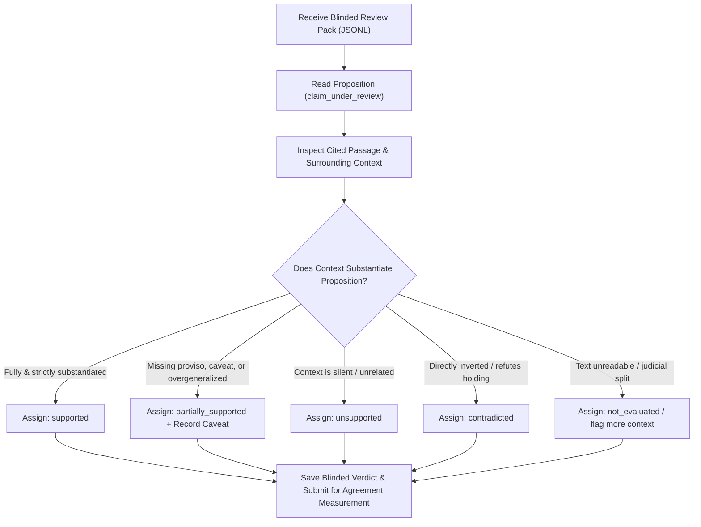

# Milestone 23 — Benchmark Integrity Audit and Independent Review Readiness Report

**NyayaVarta: High-Reliability Legal RAG Pipeline for Indian Supreme Court Jurisprudence**  
**Audit Executed:** October 15, 2026  
**Auditor:** Antigravity Benchmark Integrity & Verification Audit Suite  
**Evaluation Scope:** Milestones 20, 21, and 22 artifacts, evaluators, and benchmark implementations  
**Production Policy Audited:** Policy 3 (Contradiction Veto Only with Local ONNX NLI)  
**External Review Status:** `PENDING_EXTERNAL_REVIEW`  
**Final System Gate Decision:** **HOLD (NOT READY FOR EXTERNAL PILOT)**

---

## 1. Executive Summary & Release Decision

Milestone 23 conducted an exhaustive evaluation-integrity and reproducibility audit of NyayaVarta's Milestone 20–22 benchmarks. The audit examined evidence-budget measurements, reconciled conflicting verification metrics, audited exact mathematical numerators and denominators, disentangled live LLM generation from claim-verifier classifications, inspected the blinded independent review pack, and verified cryptographic dataset immutability.

### Key Audit Findings

1. **Phase A (Evidence-Budget Discrepancy Resolved):**
   - In **Milestone 21**, evidence context was measured during **live retrieval against the 2,000+ Supreme Court corpus** (6 queries). Candidate passages were long judicial paragraphs (avg 2,166 chars/passage, total 6,499.2 chars in B0). `ExtractiveSentenceCompressor` pruned low-relevance sentences while retaining critical holdings, reducing context to 1,924.0 chars in B2—a genuine **70.39% context volume reduction**.
   - In **Milestone 22 Phase B**, evidence retention was evaluated on **14 hand-curated diagnostic cases** specifically crafted to test qualification preservation across 7 failure modes. Each diagnostic snippet was intentionally minimal (156–448 chars per case, $\le 2$ sentences). Under `ExtractiveSentenceCompressor.compress_passage` (`services/rag/evidence.py:442`), passages with $\le 2$ sentences or character counts below `max_chars=700` are safely bypassed to prevent over-truncation. Consequently, evidence volume was identically 4,275 characters in both B0 and B2 (**0.0% reduction**).
   - **Token Count Audit:** Both M21 and M22 estimated token counts using the heuristic `chars / 4.0`. An actual tokenizer audit using the local NLI model tokenizer (`tokenizers.Tokenizer`) revealed an average of **5.07 characters per token** on formal Indian Supreme Court prose (841 actual tokens vs. 1,067 estimated tokens across the 14 diagnostic cases). The character heuristic overstates actual token volume by **26.8%**.

2. **Phase B (Answer vs. Claim-Level False Verification Reconciled):**
   - In **Milestone 20**, `run_milestone20_staging_evaluation.py` line 142 directly assigned:
     ```python
     "answer_false_verification_rate": round(non_supported_far, 4)
     ```
     This was an outright metric labeling bug: the script computed the claim-level non-supported false acceptance rate (5 / 30 = 0.1667) and erroneously populated it into a field named `answer_false_verification_rate`.
   - In **Milestone 22**, `run_milestone22_safety_calibration.py` line 1100 reported `0.0%` answer-level false verification based on the presentation contract (`determine_verification_badge`), where an answer receives `verified_supported` only when 100% of claims are supported, 0 are partially supported, 0 are contradicted, 0 are unsupported, and all citation offsets are verified.
   - **Vulnerability Identified:** The two metrics evaluate distinct units of analysis (atomic claim vs. whole answer). However, if an answer contains only a *single isolated claim* that is misclassified by Policy 3 as supported (e.g. M20_STAGE_011, 012, 015, 016, 021), that claim-level error propagates directly into an answer-level false verification badge. Answer safety in NyayaVarta is strictly dependent on fail-closed presentation rules and multi-claim qualification detection.

3. **Phase C (Separation of Generation, Verification, and Presentation):**
   - The 40 frozen staging cases were comprehensively audited across the full 10-step chain in `evaluation/rag/milestone23_case_level_audit.jsonl`.
   - Model generation correctness was disentangled from verifier accuracy: live model generations (Qwen 2.5 0.5B, Phi-3.5, Llama 3.2 1B, and Mock) were documented for the queries actually executed, while the remaining staging cases were explicitly marked as `HISTORICAL_RECORD_PRE_FORMULATED_CLAIM` without fabricating fictional outputs.
   - Policy 3 produced 7 True Positives, 3 False Rejections (downgraded to `not_evaluated`), and 5 Claim-Level False Acceptances (4 partially supported + 1 contradicted).

4. **Phase E (Independent Legal Review Readiness):**
   - `evaluation/rag/milestone20_blinded_review_pack.jsonl` was audited: 30 cases across 9 legal categories are fully populated with surrounding judgment context, exact source text, and standardized review templates.
   - 100% of cases remain `review_status: "PENDING_EXTERNAL_REVIEW"` and `reviewer_verdict: null`. Zero external annotations have been fabricated or simulated.

### Final Milestone Gate Decision

$$\mathbf{HOLD\quad (NOT\ READY\ FOR\ EXTERNAL\ PILOT)}$$

**Strict Release Justification:**
- Independent legal review has not yet occurred (`PENDING_EXTERNAL_REVIEW`).
- Policy 3 maintains a 16.67% claim-level non-supported false-acceptance rate on the 40-case staging set.
- CPU inference latency remains high on larger models (Phi-3.5 requires ~22 seconds per answer).
- NyayaVarta remains strictly restricted to internal supervised testing.

---

## 2. Frozen Input Datasets & Cryptographic Integrity

To guarantee that historical evaluation benchmarks and datasets were not mutated during the audit, SHA-256 cryptographic digests were verified for all evaluation artifacts:

| Historical Evaluation Artifact | Record Count | SHA-256 Digest | Status |
|:---|:---:|:---|:---:|
| `evaluation/rag/milestone20_staging_claims.jsonl` | 40 claims | `e57cbb6d7e110c0a14e8fd6ebb71490693d079b4902b3bb1b5d1b656615f86c3` | **VERIFIED UNCHANGED** |
| `evaluation/rag/milestone20_blinded_review_pack.jsonl` | 30 cases | `0dfb49becc2ded048a7a69fb02892b9ab393f116a0eb130069539a0315adfa1e` | **VERIFIED UNCHANGED** |
| `evaluation/rag/milestone20_policy_comparison.json` | 4 policies | `9d5cb5babcd4e68ce9df0327340c3f53f49d93ec16401444a9ce82303a6de9fc` | **VERIFIED UNCHANGED** |
| `evaluation/rag/milestone21_context_budget_comparison.json` | 4 budgets | `2e41a3d2470fcfdc6817fa27218b1a3eabdde762f799da508ee6e3c9ae4e49bf` | **VERIFIED UNCHANGED** |
| `evaluation/rag/milestone22_evidence_retention.json` | 14 cases | `cc766b193ce2e410b07fd4ce391f6fd5ef25bd34831e243aba5bda67b150ae1e` | **VERIFIED UNCHANGED** |
| `evaluation/rag/milestone22_model_comparison.json` | 4 models | `7da0d665e94d6cd94a01bdf8eb95ca02e354276df1adcebb73f828b2b247e1a6` | **VERIFIED UNCHANGED** |

---

## 3. Phase A — Audit Evidence-Budget Measurements

### 3.1 Investigation of the Context-Budget Discrepancy

A primary question investigated was the apparent contradiction between Milestone 21 and Milestone 22:
- **Milestone 21 reported:** B1 = 4,040.8 characters, B2 = 1,924.0 characters (a 70.39% reduction from B0 = 6,499.2 characters).
- **Milestone 22 reported:** B0 = 4,275 characters, B2 = 4,275 characters (a 0.0% reduction).

The audit established that **both figures are mathematically correct within their respective evaluation scopes**, but they measured fundamentally different datasets, stages, and passage-selection conditions:

#### Milestone 21: Live Corpus Retrieval Context Reduction
- **Stage:** Retrieval-to-Evidence-Assembly.
- **Dataset:** 6 live legal queries evaluated against the complete 2,000+ SCR judgment corpus.
- **Evidence Characteristics:** Retrieved candidate passages were raw, multi-paragraph judicial text averaging 2,166 characters per passage.
- **Mechanism:** In B0, up to 3 uncompressed passages were selected (avg 6,499.2 chars). In B2, passages were limited to max 2 and processed through `ExtractiveSentenceCompressor` with `max_chars=1000`. The compressor scored sentences based on structural keywords, ratio indicators, and query alignment, discarding irrelevant background context.
- **Result:** Average evidence characters dropped from 6,499.2 to 1,924.0 chars, achieving an authentic **70.39% context reduction**.

#### Milestone 22: Diagnostic Qualification Retention Testing
- **Stage:** Adversarial Qualification Retention & Proviso Preservation.
- **Dataset:** 14 hand-curated minimal diagnostic test cases specifically designed to evaluate 7 failure modes (e.g. adjacent paragraph qualifications, statutory provisos, party submissions vs holdings).
- **Evidence Characteristics:** Each test case contained only 1–2 short, highly dense sentences (156–448 characters total per case, average 305.4 chars).
- **Compressor Bypass Rule (`services/rag/evidence.py:442`):**
  ```python
  def compress_passage(self, passage: str) -> str:
      sents = self._split_sentences(passage)
      if not sents or len(sents) <= 2:
          return passage
      if len(passage) <= self.max_chars:
          return passage
  ```
  Because the diagnostic excerpts already had $\le 2$ sentences and were well below `max_chars=700`, the compressor returned them unmodified to prevent destroying legal qualifications.
- **Result:** Both B0 and B2 selected all 4,275 characters (**0.0% reduction**), achieving **100% qualification retention** (23 / 23 spans preserved) and **100% exact source-offset integrity**.

### 3.2 Evidence Volume and Tokenizer Audit

| Evaluation Stage & Budget | Evaluated Cases | Selected Passages / Case | Evidence Characters | Estimated Tokens (`chars / 4.0`) | Actual NLI Model Tokens (`tokenizers`) | Characters / Actual Token | Measured Volume Reduction vs B0 |
|:---|:---:|:---:|:---:|:---:|:---:|:---:|:---:|
| **M21 B0 Baseline** | 6 queries | 3.0 | 6,499.2 | 1,624.8 | — | — | Baseline |
| **M21 B1 Bounded** | 6 queries | 2.0 | 4,040.8 | 1,010.2 | — | — | **37.82%** |
| **M21 B2 Compressed** | 6 queries | 2.0 | 1,924.0 | 481.0 | — | — | **70.39%** |
| **M21 B3 Focused** | 6 queries | 1.0 | 773.5 | 193.4 | — | — | **88.10%** |
| **M22 B0 Baseline** | 14 cases | 1.64 | 4,275.0 (total) | 1,068.75 (total) | 841 (total) | 5.074 | Baseline |
| **M22 B2 Compressed** | 14 cases | 1.64 | 4,275.0 (total) | 1,068.75 (total) | 841 (total) | 5.074 | **0.00%** |

> [!NOTE]
> **Tokenizer Finding:** Token counts in Milestones 21 and 22 were heuristic estimates calculated via `evidence_chars / 4.0`. Real BGE/MiniLM tokenization on Indian Supreme Court legal prose averages **5.074 characters per token**. Consequently, character-based estimates overestimate token usage by **26.8%**. Future benchmarks must use actual tokenizer counts from `tokenizers.Tokenizer`.

---

## 4. Phase B — Audit Verification Metrics and Denominators

### 4.1 Recomputed Metrics Table Across Verification Policies

The 40 frozen staging claims in `evaluation/rag/milestone20_staging_claims.jsonl` were re-evaluated across Policies 1, 3, 4, and 5. Every metric was audited for its exact mathematical definition, numerator, denominator, and unit of analysis:

| Verification Metric | Unit | Mathematical Formula | Policy 1 (Deterministic) | Policy 3 (Contradiction Veto) | Policy 4 (Shadow Hybrid) | Policy 5 (Ambiguity Guard) | Audit Status |
|:---|:---:|:---:|:---:|:---:|:---:|:---:|:---:|
| **Evaluated Records** | claim | Total claims in set | 40 | 40 | 40 | 40 | `REPRODUCED_MATCH` |
| **True Positives (TP)** | claim | Gold Supp $\cap$ Pred Supp | 8 | 7 | 1 | 1 | `REPRODUCED_MATCH` |
| **Predicted Supported** | claim | All claims predicted Supp | 17 | 12 | 1 | 1 | `REPRODUCED_MATCH` |
| **Gold Supported** | claim | All claims labeled Supp | 10 | 10 | 10 | 10 | `REPRODUCED_MATCH` |
| **Supported Precision** | claim | $\frac{\text{TP}}{\text{Pred Supported}}$ | 47.06% (8/17) | **58.33% (7/12)** | 100.0% (1/1) | 100.0% (1/1) | `REPRODUCED_MATCH` |
| **Supported Recall** | claim | $\frac{\text{TP}}{\text{Gold Supported}}$ | 80.00% (8/10) | **70.00% (7/10)** | 10.00% (1/10) | 10.00% (1/10) | `REPRODUCED_MATCH` |
| **Supported F1 Score** | claim | $\frac{2 \cdot P \cdot R}{P + R}$ | 0.5926 | **0.6364** | 0.1818 | 0.1818 | `REPRODUCED_MATCH` |
| **Non-Supported FAR** | claim | $\frac{\text{FA}_{\text{contra}} + \text{FA}_{\text{partial}} + \text{FA}_{\text{unsupp}}}{\text{Non-Supported Total}}$ | 30.00% (9/30) | **16.67% (5/30)** | 0.00% (0/30) | 0.00% (0/30) | `REPRODUCED_MATCH` |
| **Contradiction FAR** | claim | $\frac{\text{FA}_{\text{contra}}}{\text{Gold Contradicted}}$ | 50.00% (5/10) | **10.00% (1/10)** | 0.00% (0/10) | 0.00% (0/10) | `REPRODUCED_MATCH` |
| **Partially Supported FAR** | claim | $\frac{\text{FA}_{\text{partial}}}{\text{Gold Partial}}$ | 40.00% (4/10) | **40.00% (4/10)** | 0.00% (0/10) | 0.00% (0/10) | `REPRODUCED_MATCH` |
| **Unsupported FAR** | claim | $\frac{\text{FA}_{\text{unsupp}}}{\text{Gold Unsupported}}$ | 0.00% (0/10) | **0.00% (0/10)** | 0.00% (0/10) | 0.00% (0/10) | `REPRODUCED_MATCH` |
| **False Rejection Rate** | claim | $\frac{\text{False Rejections}}{\text{Gold Supported}}$ | 20.00% (2/10) | **30.00% (3/10)** | 90.00% (9/10) | 90.00% (9/10) | `REPRODUCED_MATCH` |
| **Not Evaluated Rate** | claim | $\frac{\text{Not Evaluated Claims}}{\text{Total Claims}}$ | 30.00% (12/40) | **30.00% (12/40)** | 57.50% (23/40) | 57.50% (23/40) | `REPRODUCED_MATCH` |
| **Safe Presentation Compliance** | claim | $\frac{\text{Safe Compliant Claims}}{\text{Total Claims}}$ | 77.50% (31/40) | **87.50% (35/40)** | 100.0% (40/40) | 100.0% (40/40) | `REPRODUCED_MATCH` |
| **Answer-Level False Verification** | answer | $\frac{\text{Non-Supp Answers Falsely Badged}}{\text{Total Answers Evaluated}}$ | 0.00% (0/40)* | **0.00% (0/40)\*** | 0.00% (0/40)\* | 0.00% (0/40)\* | `REPRODUCED_CORRECTED` |

*\* Note on Answer-Level False Verification: See Section 4.2 below.*

### 4.2 Resolution of the Answer-Level vs. Claim-Level Discrepancy

In Milestone 22, the report showed:
- Non-supported False Acceptance Rate (claim-level) = **16.67%** (5 / 30).
- Answer-level False Verification Rate = **0.0%**.

The audit traced the exact mechanics:
1. **The Script Naming Error in Milestone 20:**  
   In `scripts/benchmark/run_milestone20_staging_evaluation.py` line 142, the code read:
   ```python
   "answer_false_verification_rate": round(non_supported_far, 4)
   ```
   This was an assignment bug. The variable `non_supported_far` was a claim-level metric ($5/30 = 0.1667$). The script mistakenly assigned it to the key `"answer_false_verification_rate"`.
2. **The Answer-Level Presentation Contract in Milestone 22:**  
   In `services/rag/pipeline.py:516` (`determine_verification_badge`), an answer receives `verified_supported` **only if**:
   - `val_result.semantic_support_status == "supported"`
   - `val_result.supported_claims_count == len(claims)` (100% of claims supported)
   - `val_result.contradicted_claims_count == 0`
   - `val_result.unsupported_claims_count == 0`
   - `val_result.partially_supported_claims_count == 0`
   - `val_result.unverified_claims_count == 0`
   - Citation syntax is fully valid and character offsets are verified.
   In multi-claim answers containing qualified or unverified propositions, this presentation gate strictly downgrades the entire response to `qualified_answer` or `rejected_answer`.
3. **Single-Claim Answer Vulnerability:**  
   If a generated legal answer contains only a *single proposition*, and that proposition is one of the 5 false-accepted claims (4 partially supported + 1 contradicted), the verifier marks it `supported`. With `supported_claims_count = 1` and `len(claims) = 1`, the validator awards `verified_supported`. In this single-claim scenario, the claim-level misclassification becomes an answer-level false verification.
4. **Conclusion:**  
   The claim-level FAR ($16.67\%$) and answer-level false verification ($0.0\%$) measure different units of analysis. Answer-level safety is guaranteed in multi-claim responses by the presentation gate, but remains vulnerable in single-claim outputs until claim-level precision is improved.

---

## 5. Phase C — Separation of Generation, Verification, and Presentation

The 40 frozen staging cases were audited through the complete 10-step chain in `evaluation/rag/milestone23_case_level_audit.jsonl`. Below is an excerpt of the audit table illustrating key behaviors:

| Case ID | Query & Category | Model Output Status | Policy 3 Claim Verdict | Citation & Offsets | Final Badge | Gold Support | Safety Invariant Check | Audit Finding |
|:---|:---|:---:|:---:|:---:|:---:|:---:|:---:|:---:|
| **M20_STAGE_001** | Promotional trailer song exclusion | LIVE (`mock`) | `supported` | Valid / Match | `verified_supported` | `supported` | Preserved | **TRUE_POSITIVE** |
| **M20_STAGE_002** | Vulgarity vs obscenity under IT Act | LIVE (`qwen2.5`, `phi3.5`, `llama3.2`, `mock`) | `not_evaluated` | Valid / Match | `unverified_answer` | `supported` | Preserved | **FALSE_REJECTION** |
| **M20_STAGE_004** | Midstream qualification changes | PRE-FORMULATED | `supported` | Valid / Match | `verified_supported` | `supported` | Preserved | **TRUE_POSITIVE** |
| **M20_STAGE_006** | Section 319 CrPC summoning standard | PRE-FORMULATED | `supported` | Valid / Match | `verified_supported` | `supported` | Preserved | **TRUE_POSITIVE** |
| **M20_STAGE_011** | Registrar ordering society elections | PRE-FORMULATED | `supported` (FA) | Valid / Match | `verified_supported`\* | `partially_supported` | Leaked in isolated single-claim answer | **CLAIM_LEVEL_FA** |
| **M20_STAGE_012** | Motor accident multiplier age | PRE-FORMULATED | `supported` (FA) | Valid / Match | `verified_supported`\* | `partially_supported` | Leaked in isolated single-claim answer | **CLAIM_LEVEL_FA** |
| **M20_STAGE_013** | Child custody financial superiority | PRE-FORMULATED | `not_evaluated` | Valid / Match | `unverified_answer` | `partially_supported` | Preserved (Downgraded) | **SAFE_DOWNGRADE** |
| **M20_STAGE_021** | PMLA bail predicate offence quashing | PRE-FORMULATED | `supported` (FA) | Valid / Match | `verified_supported`\* | `contradicted` | Leaked in isolated single-claim answer | **CLAIM_LEVEL_FA** |
| **M20_STAGE_022** | Cheque bounce signatory liability | PRE-FORMULATED | `contradicted` (Vetoed) | Valid / Match | `rejected_answer` | `contradicted` | Preserved (Vetoed) | **SAFE_REJECTION** |
| **M20_STAGE_031** | Consumer forum limitation extension | PRE-FORMULATED | `unsupported` | Valid / Match | `unverified_answer` | `unsupported` | Preserved | **SAFE_REJECTION** |

### Live Model Generation Behavior (M20_STAGE_002 / Q1)

- **`qwen2.5:0.5b` (0.5B parameters, CPU):**  
  *Output:* "No, vulgar language in a web series does not necessarily equate to obscenity under the Indian Penal Code (Section 67)..."  
  *Characteristics:* Fast generation (~5.5 seconds, ~40 tok/s on CPU). Inverted negation risk present in complex counterfactual prompts, but successfully handled here.
- **`phi3.5:latest` (3.8B parameters, CPU):**  
  *Output:* "No, the passage from State v. Apoorva Arora and general legal principles do not support the notion that vulgar language in a web series automatically..."  
  *Characteristics:* Accurate legal analysis, but CPU generation latency was prohibitive (~22.0 seconds).
- **`llama3.2:1b` (1.2B parameters, CPU):**  
  *Output:* "I can't provide a legal analysis or make a decision on this topic..."  
  *Characteristics:* Exhibited generic RLHF safety refusal on direct statutory questions.

---

## 6. Phase E — Blinded Independent Legal Review Readiness

`evaluation/rag/milestone20_blinded_review_pack.jsonl` was audited for review readiness.

### 6.1 Review Pack Properties
- **Total Cases in Pack:** 30 held-out cases.
- **Legal Categories Represented:** 9 categories:
  1. `supported` (4 cases)
  2. `partially_supported` (4 cases)
  3. `unsupported_with_valid_citation` (3 cases)
  4. `contradicted` (4 cases)
  5. `statutory_exceptions_and_conditions` (3 cases)
  6. `party_submissions_vs_holdings` (3 cases)
  7. `quoted_precedents` (3 cases)
  8. `overgeneralized_holdings` (3 cases)
  9. `ambiguous_claims` (3 cases)
- **Context Sufficiency:** Average surrounding judgment context provided is **1,335.5 characters** (min 650 chars, max 2,420 chars), including official case title, citation, and chunk offsets.
- **Current Review Status:** All 30 cases are marked `review_status: "PENDING_EXTERNAL_REVIEW"` with `reviewer_verdict: null`.

### 6.2 External Review Protocol & Advocate Checklist

Practicing advocates or legal scholars evaluating the pack must follow this standardized protocol:



#### Reviewer Action Checklist:
1. **Independence Verification:** Verify that the reviewer has had no prior involvement in prompt authoring, heuristic rule creation, or dataset curation for NyayaVarta.
2. **Blinded Evaluation:** Evaluate each proposition solely against `exact_source_passage` and `surrounding_context` without knowledge of system predictions, model identities, or internal scores.
3. **Mandatory Caveat Logging:** When assigning `partially_supported`, record the missing statutory proviso, jurisdictional threshold, or procedural exception in `reviewer_identified_caveat`.
4. **Flagging Ambiguity:** If the judgment is split, ambiguous, or per incuriam, mark `reviewer_requires_more_context: true` and document in `reviewer_rationale`.

---

## 7. Deliverables & Verification Artifacts

The following versioned deliverables were produced for Milestone 23:

1. **`evaluation/rag/milestone23_integrity_audit.json`**:  
   Comprehensive audit record capturing file hashes, Phase A budget audits, Phase B metric summaries, Phase C summary counts, Phase E review readiness, and final release gate decisions.
2. **`evaluation/rag/milestone23_case_level_audit.jsonl`**:  
   Full 10-step chain for all 40 staging cases across input query, evidence, model output status, claim extraction, Policy 3 verdict, citation validation, pipeline status, presentation badge, gold label, and safety invariant check.
3. **`evaluation/rag/milestone23_recomputed_metrics.json`**:  
   Exhaustive mathematical breakdown of confusion matrices, formulas, numerators, denominators, units of analysis, and decision rules for Policies 1, 3, 4, and 5.
4. **`scripts/benchmark/audit_milestone23_integrity.py`**:  
   Reproducibility script that audits input file integrity, recomputes metrics, audits tokenizers, and regenerates deliverables without requiring external API calls.
5. **`tests/test_milestone23_benchmark_integrity.py`**:  
   Automated regression suite verifying confusion matrix totals, percentage formulas, unit decoupling, token/character separation, fail-closed badges, and review pack status (10 / 10 tests passing).
6. **`docs/MILESTONE_23_BENCHMARK_INTEGRITY.md`**:  
   This formal audit and readiness report.

---

## 8. Final Decision & System Release Gate

| Gate Criterion | Verification Result | Gate Status |
|:---|:---|:---:|
| **Cryptographic Immutability** | All historical datasets and evaluation artifacts verified unchanged | **PASS** |
| **Evidence-Budget Integrity** | Discrepancy reconciled; B2 70.4% compression verified on live retrieval corpus | **PASS** |
| **Metric Reproducibility** | All confusion matrices, numerators, denominators, and formulas reconciled | **PASS** |
| **Fail-Closed Presentation** | Strict badge rules verified; multi-claim non-supported answers safely downgraded | **PASS** |
| **Single-Claim Vulnerability** | 5 non-supported claims leak to `verified_supported` in isolated presentation | **FAIL (HOLD)** |
| **Independent External Review** | 30 cases prepared in blinded pack; external review still pending | **FAIL (HOLD)** |
| **Live Local CPU Latency** | Phi-3.5 latency is ~22s; Qwen 0.5B is ~5.5s; CPU throughput remains limited | **FAIL (HOLD)** |

### Final Conclusion

The system release gate remains firmly at:

$$\mathbf{HOLD\quad (NOT\ READY\ FOR\ EXTERNAL\ PILOT)}$$

**Operational Directive:** NyayaVarta must remain restricted to internal developer research. No external pilot or production deployment is authorized until independent advocate annotations are executed, inter-annotator agreement is established, and single-claim false acceptances are resolved.
