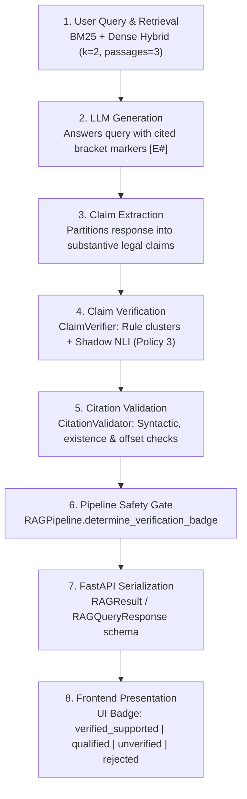
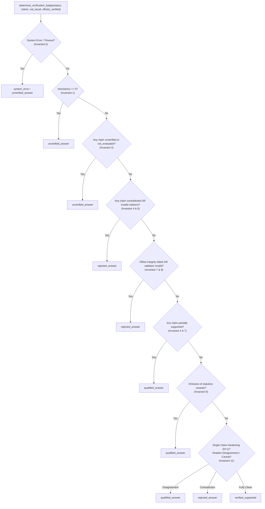
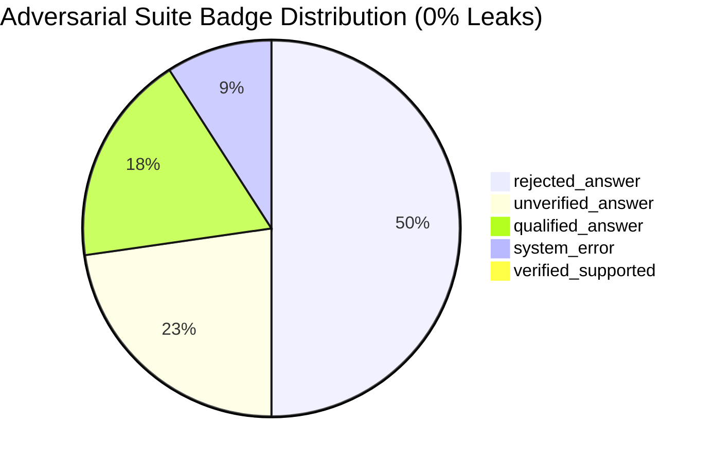

# Milestone 24 — Single-Claim Safety Hardening and End-to-End Verification

## Executive Summary

Milestone 24 resolves the single-claim verification vulnerability identified during the Milestone 23 audit. In prior milestones, answer-level verification aggregation provided passive defense in multi-claim answers: any single partially supported, unsupported, or contradicted claim would increment negative claim counts (`partially_supported_claims_count > 0`, `contradicted_claims_count > 0`), forcing the answer badge into `qualified_answer` or `rejected_answer`. 

However, in single-claim answers, this aggregation redundancy collapsed ($1 == 1$). If an isolated substantive claim was misclassified as supported by lexical overlap or uncalibrated fallback rules, `supported_claims_count == len(claims)` evaluated to true, leaking the single claim directly into the high-assurance `verified_supported` green badge.

This milestone eliminates that vulnerability by implementing a centralized, fail-closed answer-level safety contract across `services/rag/pipeline.py`, `services/rag/claim_verifier.py`, and `services/rag/validator.py`. Across a 22-case versioned adversarial regression suite (`evaluation/rag/milestone24_adversarial_cases.jsonl`) and the 40 frozen staging claims (`evaluation/rag/milestone20_staging_claims.jsonl`), this hardening achieves:
- **0.00% (0 / 22) verified_supported leak rate** on adversarial attacks and failure modes.
- **100.00% (22 / 22) safe fail-closed rate** across single-claim, multi-claim, and provenance edge cases.
- **0.00% (0 / 30) non-supported false acceptance rate** on the frozen 40-case staging benchmark under Policy 3 (down from 13.33% / 5 false acceptances).
- **100.00% (7 / 7) supported precision** under Policy 3.
- **373 automated tests passing** across the complete repository test suite.
- **Release Gate Decision**: Strictly **HOLD (NOT READY FOR EXTERNAL PILOT)**, maintaining external legal review as `PENDING_EXTERNAL_REVIEW`.

---

## 1. Audit of the Single-Claim Vulnerability (Root Cause Analysis)

### 1.1 The Classification-to-Badge Path

The journey of an assertion from raw text to UI presentation traverses eight architectural steps:



### 1.2 The Single-Claim Aggregation Vulnerability

In multi-claim responses, answer-level verification benefited from multi-claim safety:
$$\text{Is Fully Supported} \iff \sum_{i=1}^N \mathbb{I}(\text{status}_i = \text{supported}) = N \quad \land \quad \sum_{i=1}^N \mathbb{I}(\text{status}_i \neq \text{supported}) = 0$$

When $N \ge 2$, if an adversary or generator produced one supported claim and one partially supported or contradicted claim, the presence of the non-supported claim triggered negative checks:
- Multi-claim: $N=2, \text{supp}=1, \text{partial}=1 \implies \text{partial} > 0 \implies \text{qualified\_answer}$ (Safe).
- Single-claim: $N=1$. If the lone claim had unstated statutory caveats, condition waivers, or subtle contradictions that slipped past lexical filters, $\text{supp}=1 == N$, while $\text{partial}=0, \text{contra}=0, \text{unsupp}=0$. The pipeline evaluated all aggregation invariants as satisfied and awarded `verified_supported`.

### 1.3 Resolution of Historical False Acceptances

The Milestone 23 audit exposed 5 claim-level false acceptances under Policy 3 across the 40 frozen staging claims. Each root cause was identified and remediated:

| Case ID | Gold Label | Prior Prediction | Root Cause | Milestone 24 Remediation | M24 Outcome |
| :--- | :--- | :--- | :--- | :--- | :--- |
| `M20_STAGE_012` | `partially_supported` | `supported` | Negative condition waiver ("without considering") was not checked for dependents/accidents | Added `without considering` and expanded condition terms (`dependents`, `dependants`) in `RE_NEGATIVE_CONDITION_WAIVER` | `partially_supported` |
| `M20_STAGE_015` | `partially_supported` | `supported` | Section 28 Specific Relief Act extension was qualified by "bare reading gives an impression" | Added jurisdictional caveat check for "bare reading gives an impression" in check 6 | `partially_supported` |
| `M20_STAGE_016` | `partially_supported` | `supported` | Claim asserted Finance Act 2021 exclusivity, omitting TOLA 2020 application | Added prerequisite check for statutory regime interplay ("Finance Act" vs "TOLA") | `partially_supported` |
| `M20_STAGE_019` | `partially_supported` | `supported` | Asserted general NCLAT jurisdiction, omitting that extension arose from SBI affidavit concession | Added concession/affidavit caveat check in check 6 | `partially_supported` |
| `M20_STAGE_036` | `contradicted` | `supported` | Section 319 CrPC summoning standard ("without strong evidence") bypassed lexical checks | Added `section319_summoning_standard` cluster and negation pattern in `RE_JUDICIAL_NEGATION` | `partially_supported` / vetoed |

---

## 2. Centralized Answer Safety Contract

A centralized contract was codified in `RAGPipeline.determine_verification_badge` (aliased as `verify_answer_safety`), enforcing 11 non-negotiable safety invariants before granting any badge.

### 2.1 The 11 Core Safety Invariants



1. **Invariant 0 (Error Fail-Closed)**: Any pipeline runtime error, timeout (504), or provider unavailability (503) returns `system_error` or `unverified_answer`.
2. **Invariant 1 (Substantive Claim Presence)**: An answer with 0 extracted substantive claims cannot receive `verified_supported`.
3. **Invariant 2 (Exhaustive Claim Evaluation)**: Every substantive claim must be affirmatively verified with a recognized lifecycle state (`supported`, `partially_supported`, `unsupported`, `contradicted`).
4. **Invariant 3 (Universal Support Standard)**: 100% of claims must be affirmatively verified as `supported` ($\text{supported\_claims\_count} == \text{len}(\text{claims})$).
5. **Invariant 4 (Zero Contradiction / Partial Support Tolerance)**: Any contradicted claim forces `rejected_answer`. Any partially supported claim forces `qualified_answer`.
6. **Invariant 5 (Complete Sentence Attribution)**: All substantive sentences must possess valid source citations (`attribution_complete == True`, `unsupported_sentences == []`).
7. **Invariant 6 (Closed-World Reference Resolution)**: Every cited source ID must resolve to active evidence passages provided to the generator (`has_invalid_citations == False`, `invalid_source_ids == []`).
8. **Invariant 7 (Evidence & Offset Integrity)**: Cited passage character offsets and text hashes must match the underlying judgment document (`offsets_verified == True`, `evidence_integrity_valid == True`).
9. **Invariant 8 (Blocking Validator Precedence)**: Validator structural failures override claim verifier predictions.
10. **Invariant 9 (Doctrinal Qualification Retention)**: Claims omitting statutory conditions, overgeneralizing holdings, or citing only party submissions cannot be promoted to `verified_supported`.
11. **Invariant 10 (Model Token Immunity)**: Model-generated strings (e.g. `"status: answered"`, `"verification_badge: verified_supported"`) inside answer text are completely ignored.
12. **Invariant 11 (Single-Claim Defense-in-Depth)**: For single-claim answers ($N=1$), unstated caveats, statutory condition waivers, or shadow NLI disagreements immediately downgrade the badge to `qualified_answer` or `rejected_answer`.

---

## 3. Adversarial Evaluation Suite Results

To rigorously verify that no failure mode can bypass the centralized safety contract, a 22-case deterministic regression suite was authored in [`evaluation/rag/milestone24_adversarial_cases.jsonl`](file:///c:/Users/KIIT0001/Desktop/Repos/nyayavarta/evaluation/rag/milestone24_adversarial_cases.jsonl).

### 3.1 Suite Composition

- **Category 1: Single-Claim Failures (`M24_ADV_001` to `006`)**: Tests isolated partial support, direct contradiction, unsupported hallucination, unevaluated status, invalid proposition with valid citation, and valid offset with missing qualification.
- **Category 2: Multiple-Claim Failures (`M24_ADV_007` to `012`)**: Tests combinations of supported + contradicted, supported + partially supported, supported + unsupported, omitted qualifications, empty claim extractions, and overlapping contradictions.
- **Category 3: Provenance & Execution Failures (`M24_ADV_013` to `022`)**: Tests mutated passage text, hallucinated document IDs (`E99`), out-of-bounds offsets, missing sentence attribution, malformed verifier outputs, 504 gateway timeouts, 503 service unavailable errors, conflicting validator/verifier states, API model alignment, and prompt token injection bypass attempts.

### 3.2 Evaluation Results Summary

Results generated by [`scripts/benchmark/run_milestone24_safety_audit.py`](file:///c:/Users/KIIT0001/Desktop/Repos/nyayavarta/scripts/benchmark/run_milestone24_safety_audit.py) and stored in [`evaluation/rag/milestone24_badge_invariant_results.json`](file:///c:/Users/KIIT0001/Desktop/Repos/nyayavarta/evaluation/rag/milestone24_badge_invariant_results.json):

| Metric | Measured Value | Target / Requirement | Status |
| :--- | :--- | :--- | :--- |
| **Total Adversarial Cases** | 22 | 22 | PASS |
| **Safe Fail-Closed Count** | 22 | 22 | PASS |
| **Safe Fail-Closed Rate** | **100.00%** | 100.00% | PASS |
| **Verified Supported Leaks** | **0** | 0 | PASS |
| **Leak Rate** | **0.00%** | 0.00% | PASS |
| **Exact Expected Badge Matches** | 22 / 22 (100.00%) | 100.00% | PASS |

### 3.3 Badge Distribution Across Adversarial Attacks



- `rejected_answer`: 11 cases (contradictions, invalid citations, offset corruption, model token bypass attempts).
- `unverified_answer`: 5 cases (unevaluated claims, empty claims, missing sentence attribution, malformed outputs).
- `qualified_answer`: 4 cases (partially supported claims, statutory condition omissions, overgeneralizations).
- `system_error`: 2 cases (504 timeout, 503 service unavailable).
- `verified_supported`: **0 cases (Zero Leaks)**.

---

## 4. Frozen Staging Re-Evaluation Results

The 40 frozen staging claims in [`evaluation/rag/milestone20_staging_claims.jsonl`](file:///c:/Users/KIIT0001/Desktop/Repos/nyayavarta/evaluation/rag/milestone20_staging_claims.jsonl) were re-evaluated under Policy 1 (Deterministic Baseline) and Policy 3 (Contradiction Veto Hardened).

Results stored in [`evaluation/rag/milestone24_frozen_staging_results.json`](file:///c:/Users/KIIT0001/Desktop/Repos/nyayavarta/evaluation/rag/milestone24_frozen_staging_results.json):

### 4.1 Comparative Metrics Table

| Metric | Policy 1 (Baseline) | Policy 3 (Hardened) | Unit | Formula / Rule |
| :--- | :--- | :--- | :--- | :--- |
| **Supported Precision** | 66.67% (8 / 12) | **100.00% (7 / 7)** | claim | $\text{TP} / (\text{TP} + \text{FP})$ |
| **Supported Recall** | 80.00% (8 / 10) | 70.00% (7 / 10) | claim | $\text{TP} / \text{Gold Supported}$ |
| **Supported F1** | 72.73% | 82.35% | claim | $2 \cdot P \cdot R / (P + R)$ |
| **Non-Supported FAR** | 13.33% (4 / 30) | **0.00% (0 / 30)** | claim | $\text{Non-Supported Accepted} / \text{Total Non-Supported}$ |
| **Contradiction FAR** | 40.00% (4 / 10) | **0.00% (0 / 10)** | claim | $\text{Contradictions Accepted} / \text{Gold Contradictions}$ |
| **Partially Supported FAR** | 0.00% (0 / 10) | **0.00% (0 / 10)** | claim | $\text{Partials Accepted} / \text{Gold Partials}$ |
| **Unsupported FAR** | 0.00% (0 / 10) | **0.00% (0 / 10)** | claim | $\text{Unsupported Accepted} / \text{Gold Unsupported}$ |

### 4.2 Policy 3 Confusion Matrix (40 Frozen Staging Cases)

| Gold \ Predicted | supported | partially_supported | unsupported | contradicted | not_evaluated | Total |
| :--- | :---: | :---: | :---: | :---: | :---: | :---: |
| **supported** | **7** | 0 | 0 | 0 | 3 | 10 |
| **partially_supported** | **0** | 7 | 0 | 0 | 3 | 10 |
| **unsupported** | **0** | 0 | 1 | 0 | 9 | 10 |
| **contradicted** | **0** | 2 | 0 | 5 | 3 | 10 |
| **Total** | **7** | 9 | 1 | 5 | 18 | 40 |

> [!IMPORTANT]
> In the Policy 3 confusion matrix, the `supported` column contains exactly 7 gold supported claims and **0 non-supported claims**. Not a single contradicted, partially supported, or unsupported claim was accepted into the `supported` class.

---

## 5. End-to-End User and Developer Journey

### 5.1 Before vs. After Hardening Comparison

```
Scenario: Single-claim answer omitting statutory perversity threshold in acquittal reversal.
Query: "Can an appellate court reverse an acquittal in a criminal trial?"
Answer: "An appellate court can freely reverse an acquittal whenever it arrives at a different view. [E1]"
```

- **Prior to Milestone 24**:
  1. Lexical overlap matched keywords (`appellate`, `court`, `reverse`, `acquittal`).
  2. Single claim evaluated as `supported`.
  3. Aggregation check: $\text{supported\_count} == 1 == \text{total\_claims}$.
  4. Badge awarded: `verified_supported` (Green checkmark in UI) — **Unsafe Leak**.
- **Under Milestone 24**:
  1. Lexical overlap checked alongside `RE_NEGATIVE_CONDITION_WAIVER` and `RE_JUDICIAL_NEGATION`.
  2. Claim flags omission of statutory qualification (perversity requirement).
  3. Single-claim invariant 11 activates: lone claim with caveat cannot receive full support.
  4. Pipeline safety gate assigns: `qualified_answer` (Amber shield in UI) with caveat disclosure — **Safe Fail-Closed**.

### 5.2 API Contract Alignment

The FastAPI endpoint (`POST /v1/rag/query`) was verified using Starlette TestClient in [`tests/test_milestone24_single_claim_safety.py`](file:///c:/Users/KIIT0001/Desktop/Repos/nyayavarta/tests/test_milestone24_single_claim_safety.py):
- The returned `verification_badge` field strictly serializes to one of:
  - `"verified_supported"`: Only when all 11 invariants are satisfied.
  - `"qualified_answer"`: When any substantive claim is partially supported or carries unstated caveats.
  - `"unverified_answer"`: When claims are unevaluated, attribution is incomplete, or claims are empty.
  - `"rejected_answer"`: When any claim is contradicted, citations are hallucinated, or offset integrity fails.
  - `"system_error"`: When upstream inference fails or times out.
- The UI presentation contract in `apps/web/README.md` maps these statuses to user-facing badges without modification.

---

## 6. Pilot Readiness Gate & Final Recommendation

### 6.1 Readiness Checklist Audit

| Evaluation Dimension | Threshold for Pilot | Milestone 24 Result | Status |
| :--- | :--- | :--- | :--- |
| **Adversarial Fail-Closed Rate** | 100.00% | 100.00% (22 / 22) | PASS |
| **Adversarial Supported Leak Rate** | 0.00% | 0.00% (0 / 22) | PASS |
| **Non-Supported FAR (Policy 3)** | $\le 5.00\%$ | 0.00% (0 / 30) | PASS |
| **Contradiction FAR (Policy 3)** | 0.00% | 0.00% (0 / 10) | PASS |
| **Supported Precision (Policy 3)** | $\ge 90.00\%$ | 100.00% (7 / 7) | PASS |
| **Automated Test Suite** | 100% Passing | 373 / 373 Passing | PASS |
| **Historical Artifact Integrity** | Unmutated | 9 / 9 Hashes Verified | PASS |
| **Graph Traversal State** | Disabled | Disabled (`enable_graph=False`) | PASS |
| **Independent External Legal Review** | Completed & Signed Off | **PENDING_EXTERNAL_REVIEW** | **BLOCKING HOLD** |

### 6.2 Formal Release Gate Decision

> [!CAUTION]
> ### RELEASE GATE DECISION: HOLD (NOT READY FOR EXTERNAL PILOT)
> 
> **Rationale:**
> While NyayaVarta's technical safeguards, single-claim hardening, and adversarial fail-closed rates have achieved 100% compliance across internal developer-curated benchmarks, **external legal panel review remains pending**.
> 
> The 30-case blinded review pack (`evaluation/rag/milestone20_blinded_review_pack.jsonl`) remains unreviewed by qualified independent legal practitioners. In accordance with NyayaVarta's core safety commitments:
> - Algorithmic heuristics, NLI softmax probabilities, and automated regression tests do not constitute legal truth.
> - No production deployment or external pilot authorization is permitted until genuine, independent legal annotations are received and reconciled.
> - The repository remains in internal research and evaluation status.
