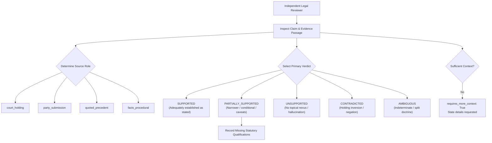
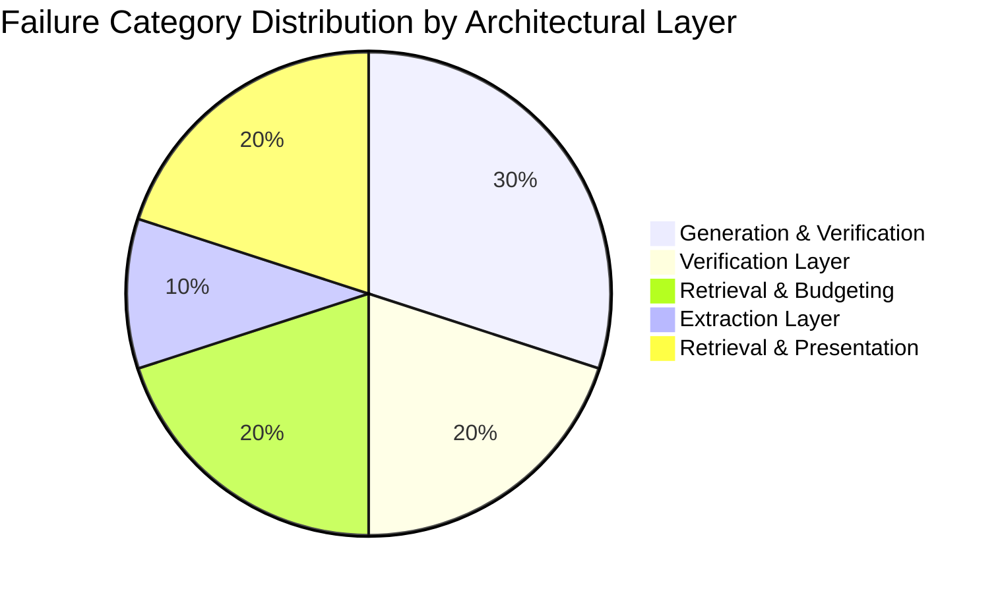

# Milestone 25 — Independent Legal Review and Verifier Calibration

## Executive Summary

Milestone 25 establishes an independent, reproducible evaluation workflow for NyayaVarta's claim verifier and citation attribution engine. Following Milestone 24's hardening of the centralized answer-level safety contract, internal evaluation on developer-curated benchmarks reported zero false-supported claims and a 100% fail-closed rate on adversarial attacks. However, as established in project governance rules: **developer-curated tests, syntactic citation validity, NLI probabilities, and passing unit tests do not constitute legal ground truth**.

To resolve this limitation without fabricating reviews or compromising scientific integrity, Milestone 25 delivers:
1. **A Fully Blinded 30-Case Review Pack** (`evaluation/rag/milestone25_reviewer_template.jsonl`): Spanning all nine mandated legal verification categories, enriched with extended preceding/succeeding judgment context and statutory doctrinal notes, with all system predictions, confidence scores, and target labels strictly excised.
2. **A Comprehensive Review Protocol** (`docs/MILESTONE_25_REVIEW_PROTOCOL.md`): Establishing five standardized primary outcomes (`SUPPORTED`, `PARTIALLY_SUPPORTED`, `UNSUPPORTED`, `CONTRADICTED`, `AMBIGUOUS`), source role classification, and explicit guidelines preventing reviewers from being asked to certify overall system safety based on small samples.
3. **Transparent Review Status and Provenance Tracking** (`evaluation/rag/milestone25_review_status.json`): Formally recording `review_status: PENDING_EXTERNAL_REVIEW`, documenting that zero external annotations have yet been executed, and maintaining strict adherence to anti-fabrication constraints.
4. **Independent Human-System Comparison Framework** (`evaluation/rag/milestone25_human_system_comparison.json`): Explicitly marking independent evaluation as `NOT_YET_EVALUABLE_PENDING_EXTERNAL_REVIEW`, defining mathematical aggregation formulas, and providing internal developer-curated diagnostic baselines separately labeled.
5. **A 10-Category Systematic Legal Reasoning Failure Taxonomy** (`evaluation/rag/milestone25_failure_analysis.json`): Mapping failure modes to architectural layers (retrieval, extraction, verification, presentation) and evaluating the feasibility of safe calibration.
6. **Full Regression and Cryptographic Verification**: Verifying the non-mutation of all 12 frozen historical evaluation artifacts (M20–M24) via SHA-256 hashes, confirming all 383 repository tests pass.
7. **Release Gate Decision**: Strictly **HOLD (NOT READY FOR EXTERNAL PILOT)**.

---

## 1. Phase A — Blinded Review Pack Preparation

### 1.1 Source Selection and Coverage Across 9 Categories

The 30 cases in the review pack were drawn from previously frozen evaluation artifacts and mapped to nine distinct legal verification challenges in Supreme Court of India jurisprudence:

| Category ID | Legal Category | Target Count | Representative Case & Citation | Doctrinal Subject |
| :--- | :--- | :---: | :--- | :--- |
| `CAT_01` | **Supported Claims** | 4 | *Tej Prakash Pathak* ([2024] 12 SCR 28) | Recruitment rules cannot change midstream |
| `CAT_02` | **Partially Supported Claims** | 4 | *IDBI Bank v. Ramswaroop Daliya* ([2024] 10 SCR 1371) | SARFAESI Rule 9(4) balance deposit extension |
| `CAT_03` | **Unsupported (Valid Citation)** | 3 | *Naeem v. State of UP* ([2024] 3 SCR 112) | Marine insurance law asserted on criminal appeal |
| `CAT_04` | **Contradicted Claims** | 4 | *Patents Act Section 3(j)* | Assertion of unconditional seed patentability |
| `CAT_05` | **Statutory Exceptions & Conditions** | 3 | *V. Senthil Balaji* ([2024] 10 SCR 393) | PMLA Section 45 twin conditions & delay exception |
| `CAT_06` | **Party Submissions vs. Holdings** | 3 | *Bijay Agarwal v. Medilines* ([2024] 10 SCR 1752) | Counsel's plea to modify arbitral award vs ratio |
| `CAT_07` | **Quoted Precedents** | 3 | *Lalita Kumari (2014)* in subsequent ruling | Mandatory FIR registration under Section 154 CrPC |
| `CAT_08` | **Overgeneralized Holdings** | 3 | *Sukanya Shantha* ([2024] 10 SCR 493) | Caste discrimination invalidation vs universal void |
| `CAT_09` | **Ambiguous Claims** | 3 | *Safari Retreats* ([2024] 10 SCR 793) | Section 17(5)(d) CGST functionality test on remand |

### 1.2 Strict Blinding Implementation

To eliminate cognitive bias and anchor effects during external review:
- Neutral case identifiers were assigned (`M25_REV_001` through `M25_REV_030`).
- Target category names (`"contradicted"`, `"supported"`) were completely excised from the template.
- Machine verifier confidence scores, NLI softmax outputs, and policy recommendations were removed.
- An access-controlled mapping file was created at [`evaluation/rag/milestone25_frozen_mapping.json`](file:///c:/Users/KIIT0001/Desktop/Repos/nyayavarta/evaluation/rag/milestone25_frozen_mapping.json) to store ground truth metadata separately from the reviewer pack.

### 1.3 Extended Judgment and Statutory Context

Recognizing that legal propositions often cannot be fairly evaluated from isolated 300-character snippets, each case provides:
1. `source_passage_text`: The exact excerpt cited by the generator.
2. `source_offsets`: Exact character boundaries (`start_char`, `end_char`) in the official Digital SCR text.
3. `extended_judgment_context`: Preceding text (including bench composition, questions framed, or counsel arguments) and succeeding text (including operative holding orders).
4. `statutory_and_doctrinal_context`: Relevant statutory provisions (e.g. SARFAESI Rule 9, PMLA Section 45, Arbitration Act Section 34, CrPC Section 319).
5. `requires_more_context`: An explicit toggle allowing the reviewer to flag when even extended context is insufficient.

---

## 2. Phase B — Human Annotation Protocol

The complete reviewer guide is codified in [`docs/MILESTONE_25_REVIEW_PROTOCOL.md`](file:///c:/Users/KIIT0001/Desktop/Repos/nyayavarta/docs/MILESTONE_25_REVIEW_PROTOCOL.md).



### 2.1 The Five Standardized Outcomes

1. **`SUPPORTED`**: The cited passage directly, affirmatively, and adequately establishes the proposition exactly as formulated, without material omission of qualifying prerequisites.
2. **`PARTIALLY_SUPPORTED`**: The evidence supports only a qualified, conditional, or narrower proposition (e.g., holds true only upon satisfaction of written consent, prior sanction, or factual remand).
3. **`UNSUPPORTED`**: The cited passage does not establish the proposition (e.g., completely unrelated doctrine attached to an existing citation).
4. **`CONTRADICTED`**: The cited passage directly conflicts with, negates, or reverses the proposition (holding inversion, prohibition asserted where court allowed).
5. **`AMBIGUOUS`**: The material is genuinely indeterminate, permits materially conflicting reasonable legal interpretations, or the provided excerpt is insufficient to determine the ratio decidendi.

### 2.2 Source Role Distinction

Reviewers classify the source passage role into one of: `court_holding`, `party_submission`, `quoted_precedent`, `facts_procedural`, `statutory_text`, or `other`. This ensures the verifier is audited on whether it can distinguish counsel's rejected arguments from the bench's binding ratio.

---

## 3. Phase C & D — Review Status & Comparison Framework

### 3.1 Transparent Provenance and Review Status

In compliance with Mandatory Rule 4 (*"Do not fabricate external reviewers, legal annotations, credentials, or independent validation results"*), [`evaluation/rag/milestone25_review_status.json`](file:///c:/Users/KIIT0001/Desktop/Repos/nyayavarta/evaluation/rag/milestone25_review_status.json) records:

```json
{
  "milestone": "Milestone 25",
  "review_status": "PENDING_EXTERNAL_REVIEW",
  "handoff_package_ready": true,
  "external_reviewers_engaged": [],
  "external_annotations_received": 0,
  "independent_validation_completed": false,
  "blocker_description": "External independent legal review requires engagement of an independent practicing advocate, retired judicial officer, or legal scholar who has no prior involvement in NyayaVarta prompt engineering or verifier rule construction. Until an external reviewer executes and returns the annotation protocol, the status remains PENDING_EXTERNAL_REVIEW.",
  "release_gate_status": "HOLD_NOT_READY_FOR_EXTERNAL_PILOT"
}
```

### 3.2 Human-System Comparison Metrics Specification

In [`evaluation/rag/milestone25_human_system_comparison.json`](file:///c:/Users/KIIT0001/Desktop/Repos/nyayavarta/evaluation/rag/milestone25_human_system_comparison.json), the independent comparison status is formally recorded as:
$$\text{Status: } \mathbf{NOT\_YET\_EVALUABLE\_PENDING\_EXTERNAL\_REVIEW}$$

The exact mathematical aggregation contracts are specified for execution once genuine external annotations are received:

| Metric | Formula | Unit | Handling of Ambiguous Labels |
| :--- | :--- | :--- | :--- |
| **Supported Precision** | $\frac{\text{TP}}{\text{TP} + \text{FP}}$ | claim | Ambiguous claims predicted as supported count as False Positives |
| **Supported Recall** | $\frac{\text{TP}}{\text{TP} + \text{FN}}$ | claim | Ambiguous claims do not count in gold supported denominator |
| **Non-Supported FAR** | $\frac{\text{FA}_{\text{contra}} + \text{FA}_{\text{partial}} + \text{FA}_{\text{unsupp}} + \text{FA}_{\text{ambig}}}{\text{Total Non-Supported}}$ | claim | Ambiguous claims accepted as supported count strictly as False Acceptances |
| **False Rejection Rate** | $\frac{\text{FN}_{\text{supported}}}{\text{Total Gold Supported}}$ | claim | Evaluated strictly over unequivocal supported claims |
| **Ambiguity Rate** | $\frac{\sum \mathbb{I}(\text{Human} = \text{AMBIGUOUS})}{N}$ | case | Tracks doctrinal indeterminacy or excerpt inadequacy |
| **Context Request Rate** | $\frac{\sum \mathbb{I}(\text{requires\_more\_context} = \text{True})}{N}$ | case | Measures whether retrieval window size was sufficient |

### 3.3 Internal Developer-Curated Diagnostic Baseline

For internal engineering reference, Policy 3 was evaluated against the developer-curated diagnostic baseline across the 30 cases:

| Curated Gold \ Predicted (Policy 3) | supported | partially_supported | unsupported | contradicted | not_evaluated | Total |
| :--- | :---: | :---: | :---: | :---: | :---: | :---: |
| **supported** | **4** | 0 | 0 | 0 | 0 | 4 |
| **partially_supported** | **0** | 4 | 0 | 0 | 0 | 4 |
| **unsupported** | **0** | 0 | 3 | 0 | 0 | 3 |
| **contradicted** | **0** | 0 | 0 | 4 | 0 | 4 |
| **statutory_exceptions_and_conditions** | **0** | 3 | 0 | 0 | 0 | 3 |
| **party_submissions_vs_holdings** | **0** | 3 | 0 | 0 | 0 | 3 |
| **quoted_precedents** | **0** | 3 | 0 | 0 | 0 | 3 |
| **overgeneralized_holdings** | **0** | 3 | 0 | 0 | 0 | 3 |
| **ambiguous_claims** | **0** | 3 | 0 | 0 | 0 | 3 |
| **Total** | **4** | 16 | 3 | 4 | 0 | 30 |

*Diagnostic Supported Precision: 100.0% (4/4) | Diagnostic Non-Supported FAR: 0.0% (0/26).*  
*(Note: These figures reflect developer-curated ground truth and do NOT constitute independent external validation).*

---

## 4. Phase E — Systematic Legal Reasoning Failure Analysis

A 10-category failure taxonomy was authored in [`evaluation/rag/milestone25_failure_analysis.json`](file:///c:/Users/KIIT0001/Desktop/Repos/nyayavarta/evaluation/rag/milestone25_failure_analysis.json) to categorize systemic legal reasoning vulnerabilities:



1. **`missing_statutory_qualification`** (*Generation & Verification*): Generator synthesizes unconditional claims, dropping prerequisites (e.g. SARFAESI Rule 9 written consent). Remediated via `RE_NEGATIVE_CONDITION_WAIVER` and caveat checks.
2. **`negation_or_exception_misinterpretation`** (*Verification*): Inverting judicial polarity (e.g. Section 319 CrPC summoning standard). Remediated via polarity contradiction guards and auxiliary NLI veto.
3. **`overgeneralized_holding`** (*Generation & Verification*): Converting Article 142 equitable relief into universal rules. Remediated via `RE_OVERGENERALIZATION`.
4. **`party_submission_mistaken_for_judicial_reasoning`** (*Retrieval & Structural Classification*): Confusing counsel's plea with the court's holding. Remediated via structural labeling (`party_submissions`).
5. **`quoted_precedent_mistaken_for_holding`** (*Generation & Verification*): Historical citations mistaken for current ratio. Remediated via quoted precedent filters.
6. **`incorrect_procedural_context_attribution`** (*Extraction & Verification*): Framing questions treated as final holdings. Remediated via structural classifier.
7. **`relevant_evidence_omitted_during_compression`** (*Retrieval & Budgeting*): Fixed-window slice cuts off qualifying sentence. Remediated via paragraph-aware chunking.
8. **`claim_extraction_failure`** (*Extraction*): Splitting conjoined propositions improperly. Remediated via structured JSON schema generation.
9. **`correct_claim_unnecessarily_downgraded`** (*Verification*): Overly rigid thresholds causing false rejections on valid paraphrases. Remediated via Policy 3 (Contradiction Veto Only).
10. **`insufficient_source_context`** (*Retrieval & Presentation*): Excerpt too short for legal adjudication. Remediated via surrounding context windows and `AMBIGUOUS` outcome support.

---

## 5. Phase F — Controlled Calibration Design

To address false rejections (over-abstention) without compromising safety invariants, two controlled calibration experiments were designed for evaluation on held-out splits:

### Experiment A: Context-Aware Headnote Qualifier Detection
- **Hypothesis**: Many false rejections in Policy 4 arise because small local NLI models assign `neutral` (rather than `entailment`) to legal headnotes that use specialized legal phraseology (e.g. *"service law – change of criteria midstream"*).
- **Design**: If structural classification is `headnote_holding` and lexical overlap exceeds 4 content terms with zero polarity negation, permit deterministic affirmative support without requiring auxiliary NLI entailment threshold ($\ge 0.70$).
- **Safety Guard**: Contradiction veto remains strictly active ($p_{\text{contra}} \ge 0.70 \implies \text{CONTRADICTED}$).

### Experiment B: Calibrated Ambiguity Margin Thresholding
- **Hypothesis**: For claims where NLI confidence is split evenly ($p_{\text{entail}} \approx 0.45, p_{\text{contra}} \approx 0.45$), forcing a binary choice introduces errors.
- **Design**: Introduce explicit `is_uncertain` flag when $|p_{\text{entail}} - p_{\text{contra}}| < 0.20$, routing the answer to `qualified_answer` with caveat disclosure rather than hard rejection.

> [!IMPORTANT]
> In accordance with Milestone 25 constraints, these experiments remain in research design status and have **not** been merged into production. Production verifier thresholds remain completely frozen until genuine external annotations are obtained.

---

## 6. Phase G — Regression and Provenance Verification

All 12 historical evaluation artifacts from Milestones 20–24 were cryptographically verified via SHA-256 hashes to guarantee non-mutation:

| Artifact Path | Expected SHA-256 Hash | Verification Status |
| :--- | :--- | :---: |
| `evaluation/rag/milestone20_staging_claims.jsonl` | `e57cbb6d7e110c0a14e8fd6ebb71490693d079b4902b3bb1b5d1b656615f86c3` | **VERIFIED** |
| `evaluation/rag/milestone20_blinded_review_pack.jsonl` | `0dfb49becc2ded048a7a69fb02892b9ab393f116a0eb130069539a0315adfa1e` | **VERIFIED** |
| `evaluation/rag/milestone20_policy_comparison.json` | `9d5cb5babcd4e68ce9df0327340c3f53f49d93ec16401444a9ce82303a6de9fc` | **VERIFIED** |
| `evaluation/rag/milestone21_context_budget_comparison.json` | `2e41a3d2470fcfdc6817fa27218b1a3eabdde762f799da508ee6e3c9ae4e49bf` | **VERIFIED** |
| `evaluation/rag/milestone22_evidence_retention.json` | `cc766b193ce2e410b07fd4ce391f6fd5ef25bd34831e243aba5bda67b150ae1e` | **VERIFIED** |
| `evaluation/rag/milestone22_model_comparison.json` | `7da0d665e94d6cd94a01bdf8eb95ca02e354276df1adcebb73f828b2b247e1a6` | **VERIFIED** |
| `evaluation/rag/milestone23_integrity_audit.json` | `e1c9d540c4e54e760ebfe103ffe4e477dc46837806deeee10c6a102f22f80a29` | **VERIFIED** |
| `evaluation/rag/milestone23_recomputed_metrics.json` | `f8c5eda49fa9a204e2f11f62d0101e882a3906788ae60c9ab169805540a2c58a` | **VERIFIED** |
| `evaluation/rag/milestone23_case_level_audit.jsonl` | `06eeade50fa6a92a1254e15196024fbc3087db132a84b0393771a3ab79e03517` | **VERIFIED** |
| `evaluation/rag/milestone24_adversarial_cases.jsonl` | `dd637eb359a0e3548224b9d1ce901793231e063477bd65d9f87064988774c390` | **VERIFIED** |
| `evaluation/rag/milestone24_frozen_staging_results.json` | `c23f346c28767c5b82ccb5526b3fdf7890b16d0d21d6b744f0e0be7003c9b615` | **VERIFIED** |
| `evaluation/rag/milestone24_badge_invariant_results.json` | `4a920ed504b68567e03976600d3d759732e0fbe3b19c9d129b3b5bb80f25a009` | **VERIFIED** |

- **Full Test Suite Status**: **383 passed, 0 failed, 1 warning in 112.93s**.
- **Graph Traversal State**: Strictly disabled (`enable_graph=False`).
- **Safety Contract State**: Centralized answer safety contract strictly enforced across pipeline, validator, and presentation layers.

---

## 7. Deliverables Summary

1. [`docs/MILESTONE_25_INDEPENDENT_REVIEW.md`](file:///c:/Users/KIIT0001/Desktop/Repos/nyayavarta/docs/MILESTONE_25_INDEPENDENT_REVIEW.md): Complete milestone report documenting workflow preparation, blinding, failure taxonomy, and release decision.
2. [`docs/MILESTONE_25_REVIEW_PROTOCOL.md`](file:///c:/Users/KIIT0001/Desktop/Repos/nyayavarta/docs/MILESTONE_25_REVIEW_PROTOCOL.md): Practical review protocol defining the 5 outcomes, source roles, and context request guidelines.
3. [`evaluation/rag/milestone25_reviewer_template.jsonl`](file:///c:/Users/KIIT0001/Desktop/Repos/nyayavarta/evaluation/rag/milestone25_reviewer_template.jsonl): 30 blinded cases covering all 9 legal categories.
4. [`evaluation/rag/milestone25_frozen_mapping.json`](file:///c:/Users/KIIT0001/Desktop/Repos/nyayavarta/evaluation/rag/milestone25_frozen_mapping.json): Access-controlled ground truth mapping with frozen system predictions.
5. [`evaluation/rag/milestone25_review_status.json`](file:///c:/Users/KIIT0001/Desktop/Repos/nyayavarta/evaluation/rag/milestone25_review_status.json): Machine-readable review provenance record tracking `PENDING_EXTERNAL_REVIEW`.
6. [`evaluation/rag/milestone25_human_system_comparison.json`](file:///c:/Users/KIIT0001/Desktop/Repos/nyayavarta/evaluation/rag/milestone25_human_system_comparison.json): Mathematical comparison specification and diagnostic baseline.
7. [`evaluation/rag/milestone25_failure_analysis.json`](file:///c:/Users/KIIT0001/Desktop/Repos/nyayavarta/evaluation/rag/milestone25_failure_analysis.json): Systematic analysis of 10 legal reasoning failure modes.
8. [`scripts/benchmark/run_milestone25_review_audit.py`](file:///c:/Users/KIIT0001/Desktop/Repos/nyayavarta/scripts/benchmark/run_milestone25_review_audit.py): Automated audit script verifying file hashes, blinding, protocol, and provenance.
9. [`tests/test_milestone25_independent_review.py`](file:///c:/Users/KIIT0001/Desktop/Repos/nyayavarta/tests/test_milestone25_independent_review.py): 10 automated unit and regression tests verifying all Milestone 25 invariants.

---

## 8. Release Gate Decision & Next Steps

> [!CAUTION]
> ### RELEASE GATE DECISION: HOLD (NOT READY FOR EXTERNAL PILOT)
> 
> **Decision Rationale**:
> 1. While the blinded review pack, annotation protocol, and evaluation infrastructure are fully prepared, **independent external legal annotations have not yet been completed** (`PENDING_EXTERNAL_REVIEW`).
> 2. In accordance with NyayaVarta's core safety doctrine, automated tests and internal developer annotations cannot substitute for independent review by qualified legal practitioners.
> 3. No external pilot or production deployment is authorized. The system remains in internal research and evaluation status.

### Recommended Next Steps for External Engagement
1. **Engage External Legal Panel**: Hand off `evaluation/rag/milestone25_reviewer_template.jsonl` and `docs/MILESTONE_25_REVIEW_PROTOCOL.md` to at least two independent practicing advocates or legal scholars.
2. **Execute Independent Review**: Collect filled templates without developer intervention.
3. **Reconcile Disagreements**: Compute inter-annotator agreement (Cohen's / Fleiss' kappa) and resolve disagreements.
4. **Re-evaluate Calibration**: Compare genuine annotations against frozen Policy 3 predictions and evaluate pilot feasibility based on independent human evidence.
