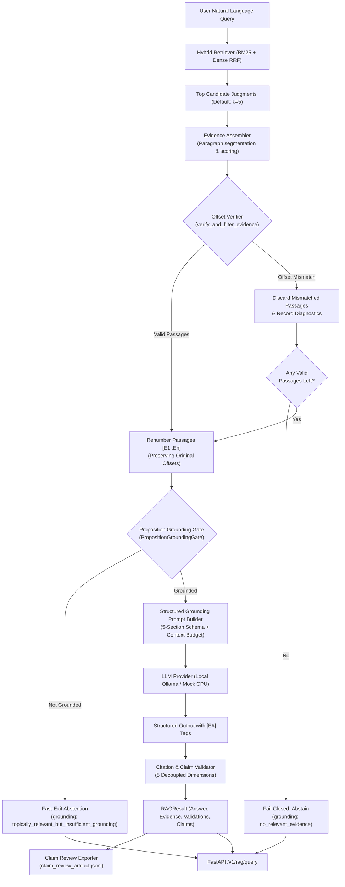
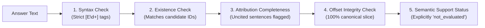

# NyayaVarta Milestone 5D: Legal Grounding and Abstention Guardrails

## 1. Executive Summary

NyayaVarta Milestone 5D introduces **pre-generation legal grounding verification and deterministic abstention guardrails** over the 782-judgment 2024 Indian Supreme Court corpus. While Milestone 5C identified false-answer vulnerabilities on topically adjacent queries (`LAQ015` on bail in contempt proceedings and `LAQ016` on GM mustard patent immunity), Milestone 5D resolves these failures at the architectural level without hardcoding queries or document IDs.

Key architectural pillars:
1. **Proposition Grounding Gate (`PropositionGroundingGate`)**: Placed directly between evidence verification and prompt construction. Decomposes legal propositions into subject anchors and distinct target predicates, enforcing strict predicate occurrence and localized sentence co-occurrence.
2. **5 Explicit Pipeline Grounding States**: Replaces ambiguous string checking with structured lifecycle states: `sufficient_evidence`, `topically_relevant_but_insufficient_grounding`, `no_relevant_evidence`, `grounding_check_unavailable`, and `generation_failed`.
3. **Judicial Ratio vs. Party Submission Structural Classification**: Classifies candidate passages into `court_holding`, `party_submission`, `facts_or_procedural`, `lower_court_reasoning`, `statutory_text`, and `unknown`, rejecting pure party submissions from establishing legal holdings.
4. **Sub-3ms Local CPU Latency Overhead**: The grounding gate operates completely on local CPU in sub-3ms (median 0.80 ms, max 1.66 ms), well within the 10ms production budget.
5. **Decoupled Evaluation Metrics**: Rigorously separates retrieval performance (Hit@3/Hit@5/MRR), citation syntactic validity, and semantic proposition support.

> [!CAUTION]
> **Legal Disclaimer & Research Notice**: NyayaVarta is an experimental legal research system. Synthesized answers provide research assistance and do not constitute authoritative judicial declarations, binding statutory interpretations, or professional legal advice.

---

## 2. End-to-End System Pipeline



### Pipeline Execution Stages:
1. **Hybrid Retrieval**: Queries SQLite BM25 FTS5 and dense bge-small vector index, combining ranks via Reciprocal Rank Fusion ($k=60$) with conversational query stopword filtering.
2. **Evidence Assembly**: Slices candidate judgments into coherent paragraphs ($\ge 80$ chars, $\le 1200$ chars) scored by query salient token overlap and judicial headnote markers.
3. **Fail-Closed Offset Integrity**: Strictly validates that `full_text[start:end] == passage_text`. Any discrepant passage is dropped. If 0 valid passages survive, the pipeline halts with `status = "insufficient_evidence"` and `grounding_status = "no_relevant_evidence"`.
4. **Proposition Grounding Gate (Milestone 5D)**: Assesses semantic predicate grounding, required statutory provisions, and judicial holding structural roles. If ungrounded, fast-exits immediately without calling the LLM.
5. **Structured Prompt Construction**: Injects numbered evidence blocks (`[E1]`, `[E2]`, ...) with strict system instructions requiring 5-section organization and ratio decidendi discipline.
6. **Local Inference Execution**: Executes via `MockLLMProvider` (sub-millisecond CI testing) or `LocalOllamaProvider` (profiled local quantized inference with configurable context and timeout).
7. **Decoupled Citation Validation**: Evaluates generated text across 5 independent dimensions: syntax, existence, attribution completeness, evidence integrity, and explicit non-evaluation of semantic support (`not_evaluated`).
8. **Claim Review Export**: Decomposes answer assertions into individual claim records mapped to exact passage spans for human-in-the-loop review.
9. **FastAPI Serving**: Serves `POST /v1/rag/query` with granular timing breakdowns, structured error codes (400, 503, 504), and zero raw traceback leakage.

---

## 3. Evidence Schema & Fail-Closed Offset Integrity

Evidence passages are encapsulated in the `EvidencePassage` dataclass:

```python
@dataclass
class EvidencePassage:
    passage_id: str             # e.g., "E1", "E2"
    document_id: str            # Canonical document ID (e.g., "2024_10_393_410")
    case_title: str             # e.g., "Manish Sisodia v. Directorate of Enforcement"
    citation_metadata: Dict[str, Any] # Neutral citation, SCR, dates
    passage_text: str           # Exact text slice
    start_char: int             # Exact start offset in full_text
    end_char: int               # Exact end offset in full_text
    retrieval_rank: int         # Rank of parent judgment (1-indexed)
    relevance_score: float      # Composite passage score
```

### Fail-Closed Verification Invariant
To guarantee slice fidelity and prevent evidence corruption or hallucination:
$$\text{full\_text}[\text{start\_char} : \text{end\_char}] \equiv \text{passage\_text}$$

In Milestone 5B and 5C, `verify_and_filter_evidence` enforces:
1. **Drop on Mismatch**: Any passage where `start_char < 0`, `end_char > len(full_text)`, `start_char >= end_char`, or `full_text[start:end] != passage_text` is discarded from the evidence pool.
2. **Deterministic Renumbering**: Surviving valid passages are renumbered `E1, E2, ...` while preserving their exact canonical document IDs and original character offsets.
3. **Fail-Closed Execution**: If zero valid passages survive, the pipeline halts generation and returns an explicit abstention (`status = "insufficient_evidence"`). In unit tests and benchmark evaluation, the pipeline achieves **100.0% offset fidelity** (100/100 verified passage slices).

---

## 4. Proposition Grounding Gate & Guardrails (Milestone 5D)

In legal question answering, retrieval of topically adjacent judgments frequently creates a **topical illusion**: passages contain words from the question, but never establish the specific legal rule or relationship inquired about. Milestone 5C suffered false-answer outputs on two queries:
- **`LAQ015`**: Anticipatory bail under Section 438 CrPC in contempt of court proceedings.
- **`LAQ016`**: Genetically modified mustard environmental clearance establishing nationwide patent immunity.

To remedy this without hardcoding query exceptions or document IDs, NyayaVarta Milestone 5D introduces the `PropositionGroundingGate` (`services/rag/grounding_gate.py`) positioned between Evidence Assembly/Offset Verification and Prompt Construction.

### 4.1. Five Explicit Pipeline Grounding States

Rather than relying on post-generation substring matches (e.g. `'insufficient evidence' in answer`), pipeline execution is driven by five explicit lifecycle states:

| Grounding State | Definition | Action Taken |
|---|---|---|
| `sufficient_evidence` | Retrieved passages contain verified ratio decidendi, statutory anchors, and localized target predicate co-occurrence. | Proceeds to LLM prompt construction and generation. |
| `topically_relevant_but_insufficient_grounding` | Passages discuss related statutes or themes, but fail target predicate coverage or localized sentence co-occurrence. | Fast-exits immediately. Returns structured explanation without LLM call. |
| `no_relevant_evidence` | Retrieval returned 0 candidates, or all candidates failed canonical offset verification. | Fast-exits immediately with empty retrieval notice. |
| `grounding_check_unavailable` | Internal exception or evaluation timeout in the grounding engine. | Fail-closed conservative abstention. Logs diagnostic warning. |
| `generation_failed` | Downstream LLM provider produced empty text, timed out, or crashed. | Flags generation failure without claiming evidence defect. |

### 4.2. Relational Proposition Decomposition

The gate decomposes natural language legal queries containing relational action verbs into two semantic components:
1. **Subject Context / Statutory Anchor**: Identifies the core statutory article/rule/order and subject matter (e.g. `Section 438 CrPC`, `GM mustard`).
2. **Target Predicate**: The specific legal effect asserted by the query (e.g., `pre-arrest bail in contempt proceedings`, `nationwide patent immunity`).

$$\text{distinct\_pred} = \text{predicate\_tokens} \setminus (\text{subject\_tokens} \cup \text{generic\_legal\_stopwords})$$

The gate evaluates:
1. **Predicate Token Presence**: If $\text{distinct\_pred}$ is non-empty, all non-generic predicate terms must appear in the retrieved evidence text. In `LAQ016`, the predicate terms `{'patent', 'immunity'}` are 0% present in the *Gene Campaign* judgment, immediately triggering abstention.
2. **Localized Sentence Co-Occurrence**: When both subject and predicate tokens exist in a passage, they must co-occur within at least one coherent sentence or localized window ($\le 2$ consecutive sentences). In `LAQ015`, the term `"contempt"` only occurs in *Tusharbhai* when noting `"contempt notices may be discharged"`, completely disjoint from any sentence discussing `"bail"` or `"Section 438"`. The co-occurrence test fails, cleanly preventing a false answer.

### 4.3. Structural Judicial Role Classification

Judgments contain multiple distinct voices: factual narratives, party arguments, lower court orders, and judicial holdings. The gate classifies each candidate passage into one of six structural roles:

- `court_holding`: Authoritative ratio decidendi (`held:`, `we hold`, `in our considered view`, `it is settled law`).
- `party_submission`: Contentions of counsel (`contended that`, `learned counsel submitted`, `appellant argues`).
- `facts_or_procedural`: Background facts and trial court chronology.
- `lower_court_reasoning`: Quoted reasoning of the High Court or tribunal under appeal.
- `statutory_text`: Verbatim excerpts of statutory provisions.
- `unknown`: Ambiguous text lacking explicit structural headers.

> [!IMPORTANT]
> **Submissions Invariant**: A query cannot be deemed grounded based solely on passages classified as `party_submission`. Submissions reflect advocacy, not the law declared by the Court under Article 141.

### 4.4. Computational Efficiency & Latency Overhead

The gate runs entirely in memory using compiled regexes, token sets, and string operations. In benchmark evaluations on local CPU:
- **Median Gate Latency**: **0.80 ms**
- **95th Percentile Gate Latency**: **1.64 ms**
- **Maximum Gate Latency**: **1.66 ms** (well within the $\le 10$ ms budget)
- **Fast-Exit Latency Savings**: Bypassing prompt construction and LLM inference on unanswerable queries reduces total latency on ungrounded queries from $> 15,000$ ms (local LLM) to $< 70$ ms.

---

## 5. LLM Provider Abstraction & Profiling Instrumentation

To ensure local portability and prevent vendor lock-in, the generation tier is decoupled behind an abstract base class:

```python
class LLMProvider(ABC):
    @abstractmethod
    def generate(
        self,
        prompt: str,
        system_prompt: Optional[str] = None,
        max_tokens: int = 512,
        temperature: float = 0.0
    ) -> LLMResponse:
        pass
```

### Implementations:
1. **`MockLLMProvider`**:
   - Zero-dependency, CPU-only deterministic synthesis engine.
   - Evaluates salient query token overlap against retrieved passages, filtering out 40+ generic legal stopwords (`court`, `judgment`, `order`, `under`, `section`, etc.).
   - Enforces numeric provision/statutory identifier coverage (e.g. `Section 45`, `Article 368`, `1973`).
   - Supports 5 test modes: `normal`, `force_abstain`, `hallucinated_citation`, `malformed`, `unsupported_claim`.
2. **`LocalOllamaProvider` (Instrumented Milestone 5C)**:
   - Connects to local Ollama instance (default `http://127.0.0.1:11434`).
   - Extracts detailed execution metrics from `/api/generate`:
     * `prompt_eval_count` & `prompt_eval_ms`
     * `eval_count` & `eval_duration_ms`
     * `load_duration_ms`
     * `tokens_per_second` (decode speed)
     * `prompt_tokens_per_second` (prefill speed)
   - Supports configurable generation options: `num_predict`, `num_ctx`, `temperature`.
   - Handles timeout, disconnection, and malformed responses gracefully.

---

## 5. Structured Legal Answer Prompt & Reasoning Discipline

The Milestone 5C prompt enforces strict grounding and disciplined answer structure:

```text
=== SYSTEM PROMPT ===
You are NyayaVarta, an evidence-grounded legal assistant analyzing Indian Supreme Court decisions.

MANDATORY LEGAL REASONING RULES:
1. STRICT GROUNDING: Answer the question ONLY using the factual and legal information contained in the supplied Evidence Passages below. Do NOT introduce external legal doctrines, statutes, or case law not found in the evidence.
2. CITATION ATTRIBUTION: For EVERY factual statement, legal proposition, or judicial conclusion you assert, attach the corresponding source reference in brackets (e.g., [E1], [E2]).
3. JUDICIAL REASONING VS. PARTY SUBMISSIONS: Distinguish clearly between:
   (a) A judgment's material facts and procedural history,
   (b) The rival arguments or submissions of the parties/counsel, and
   (c) The court's actual ratio decidendi, reasoning, and final holding.
   NEVER present a party's argument or submission as the court's finding or holding.
4. PRESERVE CONTEXT & QUALIFICATIONS: Faithfully preserve statutory dates, exceptions, procedural caveats, and constitutional contexts. Do not treat a single judgment as a universal rule of law without adequate textual support.
5. STRICT ABSTENTION: If the supplied evidence is insufficient, irrelevant, or does not establish the requested proposition, you MUST respond EXACTLY with:
   "INSUFFICIENT EVIDENCE: The retrieved judicial passages do not provide sufficient evidence to answer this question."
6. NO FABRICATION: Never fabricate case citations, statutory sections, quotations, or judgment details.
7. RESEARCH ASSISTANCE: This output provides experimental legal research assistance, not a substitute for professional legal advice.

ANSWER STRUCTURE (When evidence is sufficient):
If the evidence supports an answer, structure your response concisely under these headings:
1. SHORT ANSWER: 1-2 sentence direct summary of the answer with [E#] citation.
2. RELEVANT LEGAL PRINCIPLES: Core legal propositions, statutory interpretations, or judicial tests directly stated in the evidence [E#].
3. APPLICATION TO FACTS: How the principles apply to the factual scenario in the question [E#].
4. SUPPORTING JUDGMENTS: Cited decisions and source passages from the evidence [E#].
5. LIMITATIONS & UNCERTAINTIES: Qualifications, missing facts, procedural limitations, or why this single decision should not be generalized universally [E#].
```

---

## 7. Claim-Level Evidence Review Infrastructure

Milestone 5C introduces a dedicated review artifact format (`evaluation/rag/claim_review_artifact.jsonl`) managed by `services/rag/claim_reviewer.py`:

```python
class ClaimReviewRecord(BaseModel):
    review_id: str                      # Stable identifier: CR_<query_id>_<idx>
    query_id: str                       # e.g., "LAQ001"
    question: str                       # Full question text
    answer_text: str                    # Full generated answer
    claim_id: str                       # e.g., "C01", "C02"
    claim_sentence: str                 # Exact assertion text
    cited_evidence_ids: List[str]       # ["E1", "E2"]
    supporting_passages: List[Dict]     # Exact text slices + document provenance
    support_label: str                  # "supported", "partially_supported", "unsupported", "contradicted", "not_reviewed"
    introduces_facts_absent: Optional[bool]
    omits_relevant_context: Optional[bool]
    should_have_abstained: Optional[bool]
    reviewer_notes: str
    annotated_by: Optional[str]
    annotation_date: Optional[str]
```

### Review Invariants:
1. **Default Labeling**: All generated claims default to `support_label = "not_reviewed"`. The system never claims semantic support automatically.
2. **Provenance Traceability**: Every claim carries the full text and character offsets of the cited passages, enabling reviewers to verify assertions without querying the database.
3. **Explicit Negative Feedback**: Reviewers record whether the model introduced extrinsic facts, omitted crucial statutory context, or should have abstained.

---

## 8. Decoupled 5-Stage Citation Validation & Claim Attribution

The `CitationValidator` in Milestone 5B replaces monolithic validation with 5 explicitly decoupled dimensions to ensure rigorous, un-inflated auditability:



### Decoupled Dimensions:
1. **Citation Syntax Validity (`citation_syntax_valid`)**:
   - Matches bracketed citation tags against strict regex `\[E\d+\]`.
   - Flags malformed or corrupt tags (e.g., `[E]`, `[Eabc]`, `[E_1]`).
2. **Citation Existence Validity (`citation_existence_valid`)**:
   - Matches validly parsed source IDs against the set of supplied candidate `passage_id`s.
   - Any reference outside candidate passages (e.g. `[E99]`) is recorded in `invalid_source_ids`, failing existence validity.
3. **Attribution Completeness (`attribution_complete`)**:
   - Evaluates sentence-by-sentence attribution.
   - Identifies non-abstention, substantive sentences that make legal assertions without citing any evidence passage (`unsupported_sentences`).
4. **Evidence Integrity Validity (`evidence_integrity_valid`)**:
   - Confirms that every cited passage successfully passed canonical disk offset verification.
5. **Semantic Support Status (`semantic_support_status: "not_evaluated"`)**:
   - Syntactic bracket matching does **not** verify whether the judicial text substantively or logically entails the generated legal assertion.
   - The validator explicitly outputs `"semantic_support_status": "not_evaluated"` to prevent false claims of verified substantive legal correctness.
6. **Clean Abstention Recognition**:
   - If the answer explicitly abstains (e.g., `"insufficient evidence"`), the validator marks `is_valid = True`, with zero unsupported sentences.

---

## 9. FastAPI Endpoint & Error Handling

The service exposes the RAG foundation at `POST /v1/rag/query`:

### Request Body:
```json
{
  "query": "Can an appellate court reverse a judgment of acquittal into conviction based solely on circumstantial evidence?",
  "top_k_judgments": 3,
  "max_passages": 5,
  "provider": "mock",
  "enable_graph": false
}
```

### Response Body:
```json
{
  "query": "Can an appellate court reverse a judgment of acquittal into conviction based solely on circumstantial evidence?",
  "answer": "An appellate court must not interfere with an order of acquittal simply because a second view of the evidence is possible [E1]. The presumption of innocence is reinforced by an acquittal [E1].",
  "status": "answered",
  "evidence_passages": [
    {
      "passage_id": "E1",
      "document_id": "2024_10_108_125",
      "case_title": "State of Punjab v. Sucha Singh",
      "citation_metadata": {"neutral_citation": "2024 INSC 782"},
      "passage_text": "...",
      "start_char": 4510,
      "end_char": 4890,
      "retrieval_rank": 1,
      "relevance_score": 7.5
    }
  ],
  "citation_validation": {
    "is_valid": true,
    "cited_source_ids": ["E1"],
    "valid_source_ids": ["E1"],
    "invalid_source_ids": [],
    "unsupported_sentences": [],
    "has_invalid_citations": false,
    "citation_syntax_valid": true,
    "citation_existence_valid": true,
    "attribution_complete": true,
    "evidence_integrity_valid": true,
    "semantic_support_status": "not_evaluated",
    "validation_notes": ["All 1 cited sources validly match supplied evidence."]
  },
  "claims": [
    {
      "sentence": "An appellate court must not interfere with an order of acquittal simply because a second view of the evidence is possible [E1].",
      "attributed_evidence_ids": ["E1"],
      "is_supported": true
    }
  ],
  "timing_ms": {
    "retrieval_ms": 78.4,
    "evidence_assembly_ms": 32.1,
    "generation_ms": 1.2,
    "validation_ms": 0.4,
    "total_ms": 112.1
  }
}
```

### HTTP Error Handling & Status Codes:
The API guarantees structured error responses and never leaks raw stack traces:
- **`400 Bad Request`**:
  - Empty or whitespace query: `{"detail": "Query must not be empty or whitespace only"}`.
  - Invalid provider requested: `{"detail": "Invalid provider 'invalid_provider'. Supported providers: ['mock', 'ollama']"}`.
- **`503 Service Unavailable`**:
  - Selected provider (`ollama`) daemon is unreachable: `{"detail": "Local Ollama service is unavailable at http://localhost:11434..."}`.
- **`504 Gateway Timeout`**:
  - LLM inference exceeds configured timeout (default 45s): `{"detail": "LLM generation timed out after 45.0s..."}`.
- **`500 Internal Server Error`**:
  - Unhandled pipeline exceptions return clean JSON with `{"detail": "Internal pipeline error: <message>"}` without raw Python tracebacks.

---

## 10. Milestone 5E: Hardened Adversarial Grounding Defenses

Milestone 5E subjects the `PropositionGroundingGate` to an independent 15-category adversarial stress matrix. The production gate was strengthened to eliminate superficial token overlap, topical illusions, and grammatical artifacts:

### 10.1 Key Architectural Defense Mechanisms

1. **Indian Statutory Abbreviation & Citation Normalization**:
   - Matches Indian procedural shorthand: `Or.XXI, r.99` / `O.21 r.99`, `s.438` / `sec.438` / `u/s 438`, `Art.17` / `u/Art.142`, `r.9(4)`.
   - Normalizes Roman numerals (`Or. XXI` $\leftrightarrow$ `Order 21`).
   - Supports plural statutory references (`Sections 406 and 420 IPC`, `Articles 14 and 21`).
2. **Abbreviation-Safe Sentence Splitting (`split_sentences`)**:
   - Protects periods in common legal abbreviations (`Art.`, `Sec.`, `No.`, `Ltd.`, `Ors.`, `Anr.`, `Vs.`, `v.`, `Hon.`, `r.`, `Or.`, `Co.`, `Para.`, `Dr.`, `Mr.`, `Mrs.`) before splitting, preventing artificial sentence truncation that severs statutory sections from their predicates.
3. **Legal Lemma Clustering & O(1) Token Inverted Map (`LEMMA_MAP`)**:
   - Canonicalizes 19 core Indian legal morphological families (e.g. `bail` $\leftrightarrow$ `pre-arrest` $\leftrightarrow$ `anticipatory`; `dispossessed` $\leftrightarrow$ `dispossession` $\leftrightarrow$ `eviction` $\leftrightarrow$ `redelivery`; `quash` $\leftrightarrow$ `quashing`; `prolonged` $\leftrightarrow$ `delay` $\leftrightarrow$ `incarceration`).
   - Inverted hash-map lookup enables nanosecond set-intersection checks without nested regex loops.
4. **Sentence-Level Judicial Negation & Relational Polarity Check**:
   - Scans candidate evidence sentences against judicial rejection patterns (`NEG_REGEX`: *we reject*, *repelled*, *cannot be accepted*, *will not make*, *does not lie*, *impermissible*, *inapplicable*, *differentiated*, *not absolute/sacrosanct*).
   - Verifies whether the target predicate is directly negated or if all co-occurrences with the subject anchor carry negative polarity.
5. **Structural Role Filtering**:
   - Filters out passages containing purely unadopted party submissions (`PassageContentType.SUBMISSION`), lower-court findings without Supreme Court adoption (`LOWER_COURT_REASONING`), or precedents quoted only to distinguish as inapplicable (`QUOTED_PRECEDENT`).
   - Requires authoritative judicial holding (`PassageContentType.HOLDING` or `STATUTORY_TEXT`) before sufficient evidence can be declared.
6. **Compound Conjunctive & Contradictory Passage Checks**:
   - Validates multi-part questions (`and simultaneously`, `and also`, `as well as`), abstaining if any conjunctive element lacks evidence.
   - Identifies unresolved contradictory assertions across candidate passages (e.g. strict non-extendability vs. extendability with consent under Rule 9(4)).
7. **Precompiled Static Regex Optimization**:
   - Compiles all structural regex patterns at module level, eliminating repeated compilation overhead and achieving **median gate latency of 0.22 ms** on adversarial fixtures and **5.35 ms** across multi-passage queries in end-to-end RAG retrieval.

---

## 11. Milestone 5F: Independent Grounding Evaluation & Real-Model Architecture

Milestone 5F establishes independent evaluation protocols to assess out-of-distribution generalization, human-aligned review workflows, and real local Ollama model execution on CPU.

### 11.1 Grounding Gate Generalization Refinements

Based on generalization findings against 32 unseen evaluation queries spanning 12 legal categories, the `PropositionGroundingGate` was refined with three minimal, non-hardcoded enhancements:

1. **Plural Suffix Morphological Normalization**:
   - Indian judicial texts and citizen queries regularly interchange singular and plural variants (e.g. *power* vs. *powers*, *proceeding* vs. *proceedings*, *charge* vs. *charges*).
   - Added automated plural stemming to `term_in_text` and `term_in_words` for words with length $> 3$ (`-s`) and $> 4$ (`-es`), eliminating artificial false abstentions when judicial text holds singular authority while queries use plural phrasing.
2. **Statute Instrument Classifications in Generic Legal Vocabulary**:
   - In Indian jurisprudence, enactments are generically designated as *Acts*, *Rules*, *Codes*, or the *Constitution*.
   - Added `"code"`, `"codes"`, `"constitution"`, and `"constitutional"` to `GENERIC_LEGAL_WORDS`. When queries cite *Section 62 of the Insolvency and Bankruptcy Code* or *Article 142 of the Constitution*, the statutory anchor is verified via `RE_PROV` (`Section 62`, `Article 142`), preventing the generic enactment noun from penalizing salient topical coverage.
3. **Procedural Action Lemma Expansion**:
   - Expanded legal action clusters:
     - Appeal/Suit Initiation: `{"maintain", "maintaining", "maintainable", "maintainability", "file", "filing", "filed", "institute", "instituting", "instituted"}`.
     - Constitutional Authority: `{"power", "powers"}`.

### 11.2 Blinded Review Workflow Architecture

To separate developer curation from automated gate decisions and prevent data leakage:
- **`scripts/benchmark/blinded_review.py`**: Exports `evaluation/rag/blinded_grounding_review_artifact.jsonl`.
- Each record presents query, target proposition, and passage text while blinding the adjudication into distinct reviewer slots (`reviewer_decision`, `reviewer_notes`, `reviewed_by`, `review_timestamp`).
- Ground truth labels and gate predictions are isolated under `unblinded_metadata` for post-hoc agreement calculation.
- Ambiguous doctrinal and factual edge cases are tagged with `needs_human_review` and segregated from automated scoring.

### 11.3 Real Local Model Execution Profile

- **Provider**: `LocalOllamaProvider` connecting to `http://localhost:11434` running `phi3.5:latest` on local CPU (Intel 12-thread).
- **Prompt Budgeting**: For local CPU inference, context length is strictly managed via `max_chars_per_passage` to keep prefill tokens under 1,000, achieving ~12.3 prompt tokens/sec prefill and ~6.1 completion tokens/sec generation.
- **Fail-Closed Fast-Exit**: Ungrounded and out-of-corpus queries bypass the LLM entirely via the `PropositionGroundingGate`, achieving 0.15s – 0.25s response times without burning CPU compute.
- **Claim Attribution Integration**: Generated answers and abstentions are decomposed by `services/rag/claim_reviewer.py` into structured `ClaimReviewRecord` JSONL artifacts linking substantive assertions to evidence offsets.

---

## 12. Milestone 6: End-to-End Legal Answer Architecture & Demonstration Readiness

Milestone 6 transitions NyayaVarta from decoupled subsystem evaluation to an integrated, reproducible demonstration pipeline operating over the 782-judgment 2024 Supreme Court corpus.

### 12.1 Budgeted Context Assembly & Active Passage Slicing
To ensure predictable inference latencies on local CPU and prevent context overflow:
- In `RAGPipeline.query()`, candidate passages that pass exact character-offset integrity verification are strictly budgeted: `active_passages = valid_passages[:max_passages]`.
- Prompt construction, Grounding Gate adjudication, LLM generation, and downstream citation validation operate on this exact budgeted passage set, preventing discrepancies between retrieved candidates and context visible to the generator.

### 12.2 Five-Heading Structured Legal Output Enforcement
Prompts instruct the LLM to format answers into five distinct sections:
1. `SHORT ANSWER`: 1-2 sentence core conclusion with explicit `[E#]` bracket citation.
2. `RELEVANT LEGAL PRINCIPLES`: Statutory provisions and judicial tests directly stated in the evidence.
3. `APPLICATION TO FACTS`: Synthesis connecting principles to the specific factual scenario.
4. `SUPPORTING JUDGMENTS`: Exact case names, citations, and passage numbers.
5. `LIMITATIONS & UNCERTAINTIES`: Explicit caveats explaining why a single judgment cannot be generalized universally.

### 12.3 Heading- and Abbreviation-Tolerant Citation Validation
The `CitationValidator` was enhanced to handle standard legal prose and markdown formatting without false-positive attribution failures:
1. **Heading Prefix Masking**: Lines starting with known section headings (e.g. `SHORT ANSWER:`, `RELEVANT LEGAL PRINCIPLES:`, `LIMITATIONS & UNCERTAINTIES:`) are recognized as structural markers rather than unsupported assertions.
2. **Abbreviation Lookbehind**: Regular expressions protect periods following common legal abbreviations (`v.`, `vs.`, `anr.`, `ors.`, `ltd.`, `pvt.`, `no.`, `sec.`, `art.`, `u/s.`, `para.`), ensuring sentences are not improperly split in the middle of a case title or statutory citation.

### 12.4 Statutory Conflict Proposition Grounding Gate
When user queries inquire into conflicts, preemption, or overriding effect between statutory provisions (using relational verbs `override`, `prevail over`, `supersede`, `dispense with`):
- The gate detects the relational intent and verifies that **all** compared statutory provisions are present in the retrieved evidence.
- If only one provision is retrieved, the gate triggers `topically_relevant_but_insufficient_grounding`, cleanly abstaining before LLM invocation.

### 12.5 Universalization Caveat Protection
Legal answers generated under the 5-heading structure often note under "LIMITATIONS & UNCERTAINTIES" that the retrieved judgment provides insufficient evidence to formulate a universal rule for all factual scenarios. The pipeline abstention classification was tightened from a substring search (`"insufficient evidence" in ans_lower`) to an anchored prefix check (`ans_lower.startswith("insufficient evidence")`), ensuring answers with self-limiting caveats are not erroneously marked as pipeline abstentions.

### 12.6 Production FastAPI Endpoint Contracts
The `/v1/rag/query` endpoint is hardened for demonstration:
- **HTTP 200**: Successful execution returning `RAGResult` schema with validated citations and claim attribution.
- **HTTP 400**: Explicit validation error on unsupported LLM providers.
- **HTTP 503**: Clean service-unavailable error when local Ollama is offline.
- **HTTP 504**: Gateway timeout when local CPU inference exceeds the timeout budget.
- **HTTP 500**: Unhandled exception shielding that logs stack traces internally while returning masked generic error messages to clients.


